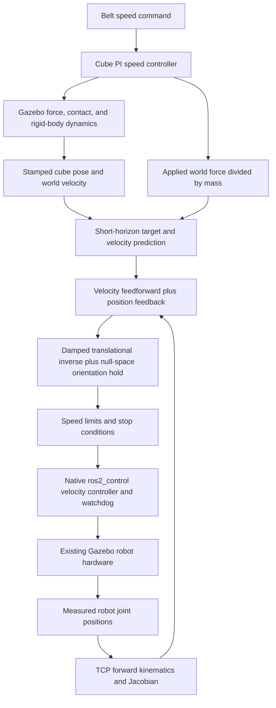

# Conveyor tracking: control theory mapped to code

This document explains the implemented moving-cube controller, including the decisions connecting the mathematical task to executable robot commands. It describes the current code rather than an idealized controller that has not been built. The scope is following one cube with a downward-facing hand, with the tool center point (TCP) 15 mm above its top. It does not close the gripper or pick up the moving cube.

For the history of simulation construction, robot import, and stationary pickup, see [PIPELINE_EXPLAINED.md](PIPELINE_EXPLAINED.md). For build and launch commands, see the [package README](src/franka_conveyor_sim/README.md#ground-truth-conveyor-following-with-joint-velocity-control).

## 1. Architecture: two stages and two different feedback loops

There are two feedback loops once tracking begins:

1. The **cube transport loop** applies a force to make the cube approach the commanded belt speed. Gazebo integrates the cube's physical motion and contacts.
2. The **robot tracking loop** uses the measured cube state and robot configuration to compute joint velocities that make the TCP follow a moving target.

The force controller does not command the robot, and the robot controller does not directly set the cube velocity.



Before those loops run together, MoveIt performs the initial approach. The belt is held at zero during that approach. This avoids asking a static motion plan to intercept an object that continues moving while planning and executing.

**Design decision:** use global collision-aware planning to establish the initial configuration, then local differential kinematics for following. A Jacobian gives instantaneous motion directions; by itself it does not find a collision-free route around the table or robot base. Repeated MoveIt planning would add planning/action latency to a task that needs frequent small corrections.

The implementation starts at the **measured** robot state, not a fabricated neutral state. A fresh simulation normally starts neutral. The method also supports a different valid measured starting state.

## 2. Source map and reading order

| Code | What to inspect |
| --- | --- |
| [`configure()`](src/franka_conveyor_sim/launch/conveyor_tracking.launch.py#L15) | One scene, matching URDF/SRDF, MoveIt setup, inactive velocity controller, tracker parameters |
| [`ConveyorTracker.run()`](src/franka_conveyor_sim/franka_conveyor_sim/conveyor_tracker.py#L144) | Initial target, MoveIt action, handoff, belt start, cleanup |
| [`ConveyorTracker.control()`](src/franka_conveyor_sim/franka_conveyor_sim/conveyor_tracker.py#L220) | One complete feedback cycle |
| [`ConveyorTracker.kinematics()`](src/franka_conveyor_sim/franka_conveyor_sim/conveyor_tracker.py#L208) | Measured joints to TCP pose and world-aligned Jacobian |
| [`resolved_velocity()`](src/franka_conveyor_sim/franka_conveyor_sim/conveyor_tracker.py#L23) | Damped least-squares inverse |
| [`tracking_rates()`](src/franka_conveyor_sim/franka_conveyor_sim/conveyor_tracker.py#L28) | Translation as primary task, downward orientation as secondary task |
| [ConveyorForce.cc](src/franka_conveyor_force_system/src/ConveyorForce.cc) | `Configure`, `PreUpdate`, `OnCommand`: physical cube transport and telemetry |
| [Velocity.cpp](src/franka_tracking_controller/src/Velocity.cpp) | Command validation, interface claims, lifecycle, watchdog, hardware writes |
| [tracking_smoke.py](src/franka_conveyor_sim/test/tracking_smoke.py) | Full simulation tests, stop/cancellation, process-death experiment |

`ConveyorTracker` inherits planning/service utilities from `PickupPlanner`. It cancels that class's automatic planning timer, overrides the worker and state construction, and does not use its camera subscription. Its inherited `/pickup/plan` trigger is explicitly rejected to prevent starting a second tracking worker.

## 3. Define the task precisely before choosing a controller

Let:

| Symbol | Meaning | Units/frame |
| --- | --- | --- |
| `q`, `qdot` | Seven arm joint angles and commanded rates | rad, rad/s |
| `p_e`, `R_e` | TCP position and orientation | m, rotation matrix, world reference |
| `p_b`, `v_b`, `R_b` | Cube center position, linear velocity, and orientation | m, m/s, world reference |
| `s` | Cube edge length, default 0.06 | m |
| `c` | Requested top clearance, default 0.015 | m |
| `K` | Robot position feedback gain, default 5 | 1/s |
| `h` | State prediction duration | s |
| `a_f` | Applied conveyor-force contribution to acceleration | m/s², world axes |

The controlled point is `fr3_hand_tcp`, not the wrist link or a fingertip. The distinction matters because the Jacobian and target must refer to the same physical point. A wrist velocity also produces TCP motion through the wrist-to-tool lever arm.

The nominal target for an upright cube is:

```text
p_target = [cube_x, cube_y, cube_z + s/2 + c]
```

At the default belt top of 0.45 m, a settled 6 cm cube has center Z approximately 0.48 m and top Z approximately 0.51 m. Therefore the target TCP Z is approximately 0.525 m. A 15 mm center offset would put the TCP inside this cube.

During tracking, the code accounts for cube orientation:

```python
cube_rotation = pin.Quaternion(ground[4]).matrix()
target[2] = (ground[1][2]
             + box_size / 2 * np.abs(cube_rotation[2]).sum()
             + clearance)
```

For a cube with rotation matrix `R_b`, its vertical half-extent is:

```text
half_height = s/2 * (|R_b[2,0]| + |R_b[2,1]| + |R_b[2,2]|)
```

This gives the top of its world-aligned bounding box. For a tilted cube it is a conservative height reference, not necessarily the height of a surface directly under the cube center. The initial MoveIt target uses `s/2`, assuming the settled cube is upright; the oriented expression is used in the live loop.

**Design decision:** regulate geometric separation of a specified TCP point. This is not a contact-force objective and does not by itself guarantee every finger surface has 15 mm clearance. The orientation hold and tested geometry are essential to avoiding finger contact.

## 4. Frames and model consistency

[`ConveyorTracker.kinematics()`](src/franka_conveyor_sim/franka_conveyor_sim/conveyor_tracker.py#L208) initializes a full Pinocchio configuration, fills it using named measured joint positions, computes forward kinematics, and extracts the seven arm columns of the TCP Jacobian:

```python
jac = pin.computeFrameJacobian(
    model, data, q, tcp, pin.ReferenceFrame.LOCAL_WORLD_ALIGNED)
```

The convention is **TCP origin, world-aligned axes**. Pinocchio's first three Jacobian rows are linear velocity and its last three are angular velocity in this convention:

```text
[v_tcp_world] = [Jv(q)] qdot
[w_tcp_world]   [Jw(q)]
```

The position error, cube velocity, force acceleration, and Jacobian output all use world axes. Applying a world-frame position error to a tool-local Jacobian would rotate the feedback incorrectly.

**Design decision:** generate the robot description from the same simulation Xacro and mappings for both MoveIt and Pinocchio. Joint geometry, fixed transforms, and the TCP offset must agree. The existing robot description, hardware interfaces, and gripper configuration are preserved.

The audited FR3 base is fixed at the world origin. There is no additional arbitrary base-to-world calibration step in this controller. Moving the robot base or changing tool geometry requires revalidating these assumptions.

The native Gazebo telemetry is defined here as world pose plus **world linear velocity**. The ROS diagnostic `nav_msgs/Odometry` message instead rotates linear velocity by `R_b.T` into its cube child frame, as that message's twist convention requires. The controller consumes native Gazebo data directly; it does not consume that republished ROS odometry.

## 5. How the cube's acceleration is generated

The conveyor surface is stationary. [ConveyorForce.cc](src/franka_conveyor_force_system/src/ConveyorForce.cc) applies a horizontal force at the cube's center of mass while a geometric contact proxy says the cube is on the belt.

For belt yaw `psi`, define the world belt axis:

```text
b = [cos(psi), sin(psi), 0]
v_measured = dot(v_b, b)
e_belt = v_command - v_measured
```

At each physics step, `PreUpdate` computes a PI speed correction:

```text
I_candidate = I + e_belt * dt
raw_candidate = Kp * e_belt + Ki * I_candidate

if |raw_candidate| <= a_max or raw_candidate * e_belt < 0:
    I = I_candidate

a_command = clamp(Kp * e_belt + Ki * I, -a_max, +a_max)
F_world = actual_mass * a_command * b
```

Defaults are `Kp=10 /s`, `Ki=2 /s²`, and `a_max=1 m/s²`. For a 0.20 kg cube the maximum commanded force magnitude is 0.20 N. The plugin uses the model's actual inertial mass, rather than assuming the configured mass matches a constant in the controller.

**Why PI here?** Contact friction is a disturbance to cube speed. Proportional feedback reacts to the speed error; integral feedback can offset a persistent disturbance. Conditional integration limits windup when force saturates. The integral resets on a speed-command change, loss of the belt contact proxy, or a simulation-time reset. Resetting on command changes favors predictable transients over retaining the previous friction-compensation state.

The proxy checks belt footprint, cube bottom height within 3 mm of the belt, and vertical speed below 0.03 m/s. It is not a contact sensor and cannot prove that a hand is not also touching the cube. Force is disabled when the proxy fails; gravity and contact dynamics continue in Gazebo. The belt's low friction is configured for Bullet as well as ODE fields in [conveyor_force/model.sdf](src/franka_conveyor_sim/models/conveyor_force/model.sdf).

**Physical approximation:** this reproduces acceleration-limited box transport using an external force; it does not model the traction or compliance of a real moving belt. No pose or velocity setter is used to move the cube.

The acceleration provided to the robot is:

```text
a_f = F_world / actual_mass
```

The actual physical equation also includes contact forces and gravity:

```text
mass * a_net = F_world + F_contact + F_gravity
```

Consequently `a_f` is not an exact measurement of net acceleration. This distinction explains why the robot also uses measured cube velocity and feedback rather than integrating `a_f` indefinitely.

## 6. Ground truth, timestamps, and short prediction

[`on_ground()`](src/franka_conveyor_sim/franka_conveyor_sim/conveyor_tracker.py#L85) stores the cube's simulation timestamp, position, world velocity, orientation, and wall-clock receipt time. [`on_acceleration()`](src/franka_conveyor_sim/franka_conveyor_sim/conveyor_tracker.py#L93) stores the forcing acceleration and its simulation timestamp.

Both originate from the force plugin's `PreUpdate`, at up to 100 Hz. These are pre-physics-step state samples; the code does not claim a post-step synchronized sensor measurement. Native transport callbacks run separately, so the tracker takes a locked snapshot before each cycle. Pose and acceleration travel on separate topics and are not guaranteed to arrive together.

For a cube sample stamped at `t_b`:

```text
age = current_ROS_simulation_time - t_b
h = max(0, age) + prediction_horizon
p_predicted = p_b + v_b*h + 0.5*a_f*h²
v_predicted = v_b + a_f*h
```

`prediction_horizon` defaults to 10 ms. The forcing acceleration is used only if its timestamp differs from the cube-state stamp by less than 30 ms; otherwise the code substitutes zero acceleration and still uses measured velocity.

**Design decision:** make a short local prediction to account for state age and expected actuation delay. This assumes approximately constant forcing acceleration over `h`; it is not MPC and does not optimize future commands. The additional horizon is configurable from 0 to 50 ms. The total `h` also includes message age, so it is not globally capped at 50 ms. Accepted state age can extend it to approximately 200 ms at the largest configured horizon.

The vertical predicted position is overwritten by the current measured cube top plus clearance. The vertical command also omits cube vertical velocity and acceleration feedforward. This is a deliberate flat-belt simplification: follow horizontal transport while regulating height, rather than chasing small contact-bounce velocities. It is not a general 3D airborne-object tracker.

**Why ground truth first?** It separates feedback/kinematics problems from camera noise, occlusion, differentiation, and latency estimation. It does not establish how the same gains will behave with vision. A future estimator needs timestamped position and velocity in the same frame; orientation is also needed for the current top-height computation.

## 7. The robot feedback law and its ideal error dynamics

[`control()`](src/franka_conveyor_sim/franka_conveyor_sim/conveyor_tracker.py#L220) forms:

```python
error = target - position
velocity = ground_velocity + acceleration * horizon + position_gain * error
velocity[2] = position_gain * error[2]
```

The error sign is **target minus TCP**. If the TCP is behind the cube in X, positive error adds forward velocity.

Ignoring prediction for a moment, take a moving target `p_d` with velocity `v_d` and define `e = p_d - p_e`. If the robot achieves the commanded Cartesian velocity exactly:

```text
v_e = v_d + K*e
edot = v_d - v_e = -K*e
e(t) = e(0) * exp(-K*t)
```

This is the reason for velocity feedforward: when the TCP is exactly aligned with a moving cube, it should still move at the cube speed. With position feedback alone, constant-speed tracking in this ideal model needs a steady lag `e = v_d/K`; at 0.1 m/s and K=5/s that is 20 mm.

For K=5/s, the ideal exponential time constant is 0.2 s. At a nominal 10 ms sampling period, a delay-free Euler approximation gives:

```text
e[k+1] = (1 - K*T) * e[k] = 0.95 * e[k]
```

That calculation is intuition for the gain, **not a stability proof of the implemented system**. Prediction changes the reference; `v_predicted` need not equal its exact time derivative when acceleration or message age changes. Jacobian damping, rate limits, transport delay, actual hardware response, and the orientation task also affect the dynamics.

**Why no integral term in robot position control?** Feedforward handles the known target motion and proportional feedback removes local position error in the ideal case. An integral term would add state, windup handling, and possible overshoot near clearance/workspace limits. Small model or delay biases are accepted in this first controller. The cube's PI speed loop and the robot's P position loop solve different problems.

## 8. Translational Jacobian inversion

The primary task is:

```text
Jv(q) * qdot = v_requested
```

`Jv` is 3-by-7: three translational tasks and seven joints. When it has full row rank, many joint motions produce the same translation. Near singularities, some Cartesian directions become difficult to produce without large joint rates.

[`resolved_velocity()`](src/franka_conveyor_sim/franka_conveyor_sim/conveyor_tracker.py#L23) implements:

```python
return jacobian.T @ np.linalg.solve(
    jacobian @ jacobian.T + damping**2 * np.eye(3), velocity)
```

Equivalently:

```text
qdot_primary = Jv.T * (Jv*Jv.T + lambda²*I)^-1 * v_requested
lambda = 0.02
```

This is the solution to the regularized least-squares objective:

```text
minimize ||Jv*qdot - v_requested||² + lambda²*||qdot||²
```

`np.linalg.solve` solves the small linear system without explicitly constructing its inverse. The positive damping term keeps that system nonsingular even when the Jacobian loses rank.

For a singular value `sigma`, the inverse gain is `sigma/(sigma² + lambda²)`. Unlike `1/sigma`, it does not diverge as `sigma` approaches zero. The price is imperfect Cartesian velocity tracking. In particular, `Jv*qdot_primary` generally differs from `v_requested`, even without saturation.

**Design decisions and tradeoffs:** use a compact damped inverse rather than a constrained optimizer; favor bounded numerical behavior over exact inversion near singularities; use a fixed damping value rather than adaptive singular-value scheduling. The numerical value 0.02 depends on the Jacobian's units and robot scale. The angular secondary task uses the same numerical damping despite different task units; this is a practical tuning choice, not a normalized, universally optimal weighting.

There is no explicit manipulability-maximization or joint-centering objective. Pinocchio's `neutral()` in `kinematics()` initializes the configuration array before measured joints are filled; it is not a command to return to neutral.

## 9. Why translation needed an orientation task

A full-rank translational Jacobian leaves four joint-space degrees of freedom. Regulating TCP position does not determine the hand orientation. An early full simulation run kept the point near its target but rotated a fingertip into the cube and pushed it sideways.

The initial MoveIt orientation is quaternion `(x,y,z,w)=(1,0,0,0)`, corresponding to:

```text
R_desired = diag(1, -1, -1)
```

Tool +Z points down. The tracker holds this fixed full orientation, including yaw, rather than aligning yaw to a moving cube.

[`tracking_rates()`](src/franka_conveyor_sim/franka_conveyor_sim/conveyor_tracker.py#L28) computes the world-frame rotation error:

```python
rotation_error = pin.log3(R_desired @ R_current.T)
```

The logarithm gives a three-component rotation vector in radians. This avoids Euler-angle subtraction. It still has the usual ambiguity at a relative rotation of 180 degrees; the initial MoveIt orientation keeps the live loop near the intended orientation rather than relying on a global rotation-error controller.

For the primary task, construct:

```text
N = I7 - pinv(Jv)*Jv
```

This uses the ordinary Moore–Penrose pseudoinverse. In exact arithmetic `Jv*N=0`, so motion through `N` does not change TCP translation. With `Jw` the angular Jacobian:

```text
omega_desired = 4 * rotation_error
angular_residual = omega_desired - Jw*qdot_primary
A = Jw*N
qdot_secondary = N * A.T * (A*A.T + lambda²*I)^-1 * angular_residual
qdot_total = qdot_primary + qdot_secondary
```

Subtracting `Jw*qdot_primary` matters: the primary translation already rotates the hand, so the secondary task must compensate for that motion as well as reduce the current orientation error. The angular gain is 4/s.

**Why use an undamped pseudoinverse for `N`?** A projector formed from the damped primary inverse would generally leak secondary motion into the translational task. The current projection preserves primary translation up to numerical precision before the final speed scaling. However, the rank decision and pseudoinverse can change sharply near singularities; the code does not provide a smooth, rank-aware task-priority proof.

**Why not solve one combined 6D task?** The implemented hierarchy makes translation the explicit primary objective requested for tracking. Orientation uses remaining motion authority. Neither orientation accuracy nor the primary requested speed is guaranteed after saturation, and orientation holding does not constitute a whole-hand collision-avoidance constraint.

## 10. Limits change the controller's behavior

The code applies limits in this order:

1. Scale the Cartesian translation vector to a maximum norm of 0.25 m/s.
2. Compute the primary and secondary joint rates.
3. Scale the entire seven-joint vector so its largest absolute rate is at most 1.5 rad/s.
4. Stop if a joint within 0.08 rad of a position limit is commanded further toward that limit.
5. Stop if rates are nonfinite or the predicted position-error norm exceeds 0.05 m.
6. Publish the joint-rate vector.

Uniform joint-vector scaling preserves its direction and the translation/orientation mixture, but reduces the achieved speed. It avoids independently clipping Python's joint rates into a different motion direction. The native plugin additionally clamps each joint defensively.

**Design decision:** stop at a joint margin rather than solve a joint-limit-constrained optimization problem. There is no joint-limit barrier, acceleration/jerk limiter, torque-limit optimization, or collision constraint inside the inverse. Damping is also not a substitute for those constraints.

The default cube tracking interval is `-0.05 < cube_x < 0.42 m`. A normal run begins near X=0.15 m, giving approximately 0.27 m of travel. The end boundary was chosen from physical testing of the downward-tool configuration: tracking farther encountered loss of motion authority. It is a tested operating bound, not an analytically computed full reachable set. Raising it requires validating the new region rather than merely changing a number.

The cube must initially be within 5 mm of the conveyor centerline. During tracking, a lateral displacement beyond 20 mm or center-height deviation beyond 5 mm from nominal stops the run. These checks constrain the tested scenario; they do not generalize the controller to arbitrary cube positions or disturbances.

## 11. MoveIt approach and controller handoff

[`run()`](src/franka_conveyor_sim/franka_conveyor_sim/conveyor_tracker.py#L144) performs the following sequence:

1. Command zero belt speed and wait 0.3 seconds of wall time.
2. Snapshot cube and robot state; require initial centerline alignment.
3. Use [`PickupPlanner.install_scene()`](src/franka_conveyor_sim/franka_conveyor_sim/pickup_planner.py#L165) to add belt, cube, floor, table, and legs to MoveIt.
4. Construct the downward TCP target above the cube on the centerline.
5. Use [`PickupPlanner.ik()`](src/franka_conveyor_sim/franka_conveyor_sim/pickup_planner.py#L229) with collision avoidance, then [`plan_joints()`](src/franka_conveyor_sim/franka_conveyor_sim/pickup_planner.py#L207) with OMPL RRTConnect.
6. Execute the resulting trajectory directly through `fr3_arm_controller/follow_joint_trajectory` and require action success.
7. Strictly switch off the position trajectory controller and switch on the velocity controller.
8. Enable the 100 Hz loop, then command the belt speed.

The inherited planning defaults include a 5 s planning allowance and 0.1 velocity/acceleration scaling. The tracker overrides `state()` so the initial state preserves the measured finger configuration rather than inheriting the stationary planner's open-hand assumption. It does not command a gripper opening.

**Design decision:** keep one owner of arm commands in each mode. MoveIt supplies the initial trajectory, while the coordinator owns action execution and switching. The launch sets `allow_trajectory_execution=False` and `moveit_manage_controllers=False` on MoveIt; that does not disable the coordinator's direct action execution.

[`switch()`](src/franka_conveyor_sim/franka_conveyor_sim/conveyor_tracker.py#L134) requests a strict ros2_control transition with a 5 s timeout. The custom controller claims `fr3_joint1/velocity` through `fr3_joint7/velocity`. It does not replace the existing hardware abstraction, robot description, or finger controllers.

The 0.3 s setup wait is not a measured zero-velocity acknowledgement. With `start_sim:=false`, the existing compatible scene must begin with the belt stopped. There is also no general moving-target interception during the approach phase.

## 12. Sampling, concurrency, and the native watchdog

| Layer | Timing in current implementation | Purpose |
| --- | --- | --- |
| Gazebo physics/force update | Nominal 1 ms physics step | Integrate physical cube and robot behavior |
| Force-plugin state telemetry | Up to 100 Hz simulation time | Provide pose, velocity, and forcing acceleration |
| Python Cartesian loop | 10 ms ROS simulation-time timer | Compute new joint rates |
| Existing controller manager | Configured 1000 Hz | Update active hardware command interfaces |
| Native command watchdog | 200 ms steady-clock age limit | Zero commands if the publisher stops |
| Trace logging | About every 50 ms simulation time | Record evidence without saving every cycle |

These are configured/scheduled rates, not guarantees that Python callbacks execute with zero jitter. The native controller holds the latest received command between updates: effectively a zero-order hold. The commanded velocities are implemented by the existing Gazebo hardware backend; this code does not compute robot torque or a Cartesian impedance law.

The MoveIt/service worker runs separately so action/service waits do not block the ROS callbacks that receive joints or execute the timer. A mutex protects the state shared with native Gazebo callbacks. Cube state and robot joints are nevertheless asynchronous snapshots; the implementation does not interpolate all signals onto a common timestamp or predict the robot state forward.

[Velocity.cpp](src/franka_tracking_controller/src/Velocity.cpp) rejects vectors whose length is not seven or that contain nonfinite values. Valid rates are stored in atomic variables and the receipt time is recorded using a monotonic steady clock. The update callback writes zero if that receipt time is older than 200 ms. Activation invalidates any old command; the next update therefore writes zero until a new command arrives. Deactivation explicitly writes zero.

**Why two clocks?** Simulation time describes physical state age and pauses consistently with Gazebo. Steady wall time detects a stalled/dead command process independently of simulation timestamps. During a Gazebo pause the physical system does not move; the wall-clock watchdog is evaluated when controller updates execute, including after resumption. This is not a hardware emergency-stop mechanism.

The native plugin stores individual joint commands atomically; it does not use a transactional seven-joint realtime buffer. A subscription update can theoretically overlap a hardware update, so one hardware cycle can read a mixture of adjacent command vectors. This remains a simulation-oriented implementation, not a claim of a formally synchronized hard real-time command path.

## 13. Stop behavior and the boundary of the safety checks

Before computing a command, `control()` checks:

| Condition | Current threshold/action |
| --- | --- |
| Stop service requested | End tracking |
| Cube simulation stamp ahead of ROS clock | Stop if ahead by more than 20 ms |
| Cube simulation-state age | Stop if older than 150 ms |
| Cube or joint receipt age | Stop if no receipt for more than 300 ms wall time |
| Cube leaves validated belt corridor | Stop at the lateral/height limits above |
| Cube reaches X bounds | End tracking |

A very small negative state age is tolerated for asynchronous clocks and is clamped to zero in prediction. Large clock reversal is treated as invalid state rather than attempting to continue through a reset. Joint freshness uses wall receipt age, not a joint-header-time synchronization test.

On a normal stop, the worker commands belt speed zero, sends zero joint velocities, and switches back to the original position controller, which holds the arm near its current pose. Belt speed zero invokes the cube's acceleration-limited speed loop; it is not an instantaneous physical freeze. The arm does not automatically return to neutral in this tracking path.

Cancellation during approach requests action cancellation. Killing the Python process cannot execute its cleanup: only the native watchdog remains to zero arm velocities. It cannot restore the position controller or stop the belt on behalf of the dead process.

The initial approach is MoveIt collision checked. The live velocity loop does not repeatedly query collision validity, update the moving cube in MoveIt's scene, or enforce swept-volume clearance. A 15 mm TCP target, orientation hold, corridor checks, and successful default-scene tests are useful engineering measures, but are not a proof of collision-free motion for changed geometry or contact disturbances.

## 14. Which choices are configurable, and which are in code?

| Choice | Current default | Where to change |
| --- | --- | --- |
| Cube top clearance | 0.015 m, initialization requires at least this | Launch `clearance` |
| Robot position gain | 5/s | Launch `position_gain` |
| Additional prediction horizon | 0.01 s, allowed 0–0.05 | Launch `prediction_horizon` |
| Initial commanded tracking speed | 0.1 m/s, constructor accepts `(0, 0.2]` | Launch `belt_speed`; only default tracking performance is reported here |
| Downstream tracking limit | Cube X=0.42 m | Launch `tracking_end_x` |
| Upstream tracking limit | Cube X=-0.05 m | Node parameter `tracking_min_x`, not forwarded as a launch argument |
| Belt/table/cube geometry | Existing scene defaults | Tracking launch geometry arguments |
| Damping and angular gain | 0.02 and 4/s | `resolved_velocity`, `tracking_rates` |
| Cartesian/joint speed caps | 0.25 m/s, 1.5 rad/s | Python `control`; native joint cap also in `Velocity.cpp` |
| Freshness, corridor, error and joint margins | Values above | Python `control` |
| Native watchdog | 200 ms | `Velocity::update` |
| Cube PI gains and force limit | 10/s, 2/s², 1 m/s² | Force plugin SDF/configuration; not forwarded by the tracking wrapper |

The current controller targets the named FR3 and single `box_pickup` cube. Its robot names, ground-truth topic names, full-orientation reference, and several limits are deliberately explicit. Generalizing to another robot, moving base, cube stream, tool, or belt geometry needs more than changing K.

## 15. What was tested, and what the measurements mean

[The saved full-run metrics](src/franka_conveyor_sim/test/results/conveyor_tracking_tracking_validation.json) report 49 samples over 2.73 s simulation time, approximately 0.27 m travel, with maximum absolute errors:

| Axis | Maximum sampled error |
| --- | --- |
| X | 2.085 mm |
| Y | 0.263 mm |
| Z relative to nominal 15 mm top clearance | 0.295 mm |

The [durable trace](src/franka_conveyor_sim/test/results/conveyor_tracking_tracking_trace.json) contains cube position, FK TCP position, cube velocity, applied-force acceleration, commanded joint rates, and orientation-error magnitude. The test computes error against cube center plus 45 mm for the default upright 6 cm cube. It also checks lateral cube motion below 1 mm and orientation error below 0.02 rad. These are sampled maxima, not continuous-time worst-case bounds or an independent optical TCP measurement.

[`test_translational_jacobian_matches_finite_difference()`](src/franka_conveyor_sim/test/test_tracking_kinematics.py#L10) perturbs each arm joint on the actual URDF and checks the TCP position derivative. [`test_null_space_orientation_preserves_translation()`](src/franka_conveyor_sim/test/test_tracking_kinematics.py#L32) checks that the secondary term leaves the primary translation unchanged numerically before scaling. [`test_damped_solution_remains_finite_at_singularity()`](src/franka_conveyor_sim/test/test_tracking_kinematics.py#L41) tests finite rates for a rank-deficient Jacobian.

Full simulation tests also exercised normal workspace completion, requested stopping, approach cancellation, and command-publisher death. Normal completion restored the original arm controller. In the process-death experiment, measured joint speeds were below 0.00011 rad/s after allowing 0.7 s for watchdog action. This verifies stopping in that experiment; it does not measure an exact 200 ms physical stopping time. Separate force-conveyor regressions exercised positive, zero, and negative speeds, pause, airborne force cutoff, and off-belt force cutoff.

No new physics run is needed to read this document. To reproduce the existing checks after building and sourcing the workspace:

```bash
python3 -m pytest -q src/franka_conveyor_sim/test/test_tracking_kinematics.py
python3 src/franka_conveyor_sim/test/tracking_smoke.py
python3 src/franka_conveyor_sim/test/tracking_smoke.py --mode stop
python3 src/franka_conveyor_sim/test/tracking_smoke.py --mode stop-approach
python3 src/franka_conveyor_sim/test/tracking_smoke.py --mode watchdog
```

## 16. How to reason about tuning and future changes

These are engineering considerations for changes, not features already implemented:

- **Feedback gain:** increasing K reduces ideal position-error decay time but magnifies measurement noise and requests larger rates. Once limits engage, the simple `edot=-K*e` argument no longer applies. Inspect commanded rates and lag together.
- **Prediction:** compare transient error with the additional horizon set to zero and at 10 ms. A larger horizon can turn uncertain forcing acceleration into systematic lead error; it does not repair unmeasured transport latency.
- **Damping:** reducing lambda increases task accuracy away from singularities but can increase rates near weak directions. A singular-value trace would help select adaptive damping; it is not currently recorded.
- **Orientation:** a fixed full orientation costs more motion authority than keeping only tool Z downward. Relaxing yaw could enlarge the usable region, but would change finger orientation and needs contact/clearance testing.
- **Redundancy and limits:** a joint-centering or manipulability objective could improve configuration quality. A constrained QP could incorporate joint rates, joint-position margins, and selected collision constraints more systematically than scaling and stopping.
- **Dynamics:** joint velocity actuation in Gazebo hides physical actuator bandwidth, acceleration, torque, compliance, and communication limitations. Deployment on a real Franka requires a suitable hardware control interface and validation of those dynamics, rather than assuming this simulation plugin transfers directly.
- **Vision:** measured pose noise and estimated velocity introduce another feedback path and delay. State uncertainty, time synchronization, filtering, and loss-of-track behavior must be designed before reusing the ground-truth gains unchanged.
- **Moving pickup:** tracking a clearance point is only the approach phase. A moving grasp adds contact geometry, closure timing, relative velocity at contact, object attachment assumptions, and transition logic that are outside this implementation.

The most useful debugging order is: verify frame/TCP conventions, inspect cube state and timestamps, compare requested Cartesian motion with rate saturation, inspect orientation and joint margins, and only then adjust feedback gains. A gain change cannot correct a wrong frame, an unreachable task, or simultaneous arm command owners.
