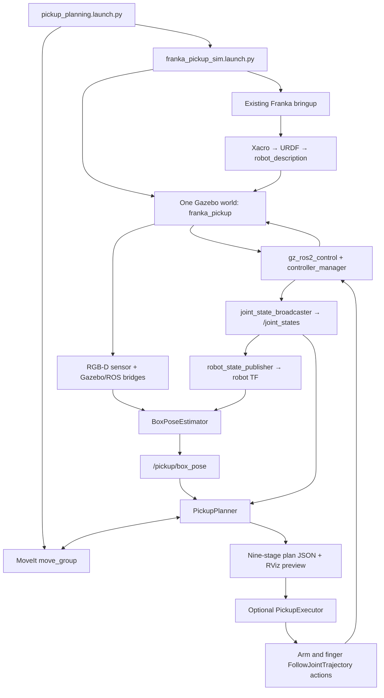
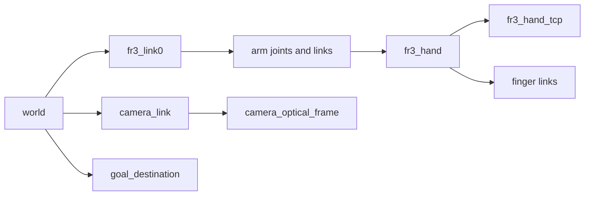
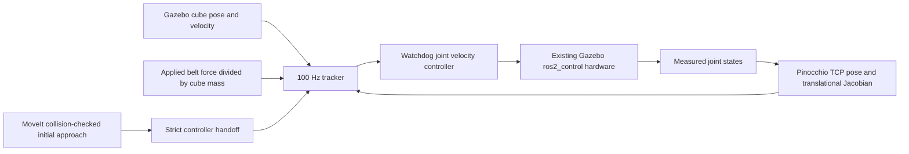

# Franka simulation pipeline: from world creation to physical pick and place

This is a source-guided explanation of the workspace as of **19 October 2026**. It follows the project from the original conveyor environment to the current camera-guided, stationary pick–place–return task. Read it from the workspace source tree: links point to real files and, for Python functions, their current line numbers.

The current demonstrated manipulation task is: observe a known red cube, plan from neutral, approach with an oriented gripper, close, lift, carry to the yellow circle, release, retreat, and return to neutral. The original robot stack already existed. The environment package adds the scene, perception, planning client, and optional execution around it. Section 17 explains the subsequent force-driven conveyor mode.

## Reading map

1. [The architecture](#1-the-architecture)
2. [How the project evolved](#2-how-the-project-evolved)
3. [Workspace and build](#3-workspace-and-build)
4. [Creating the Gazebo world](#4-creating-the-gazebo-world)
5. [Importing the robot](#5-importing-the-robot)
6. [The conveyor experiments](#6-the-conveyor-experiments)
7. [The current pickup scene](#7-the-current-pickup-scene)
8. [Camera data, frames, and time](#8-camera-data-frames-and-time)
9. [Estimating the cube pose](#9-estimating-the-cube-pose)
10. [Starting MoveIt](#10-starting-moveit)
11. [Planning the complete task](#11-planning-the-complete-task)
12. [Executing through ros2_control](#12-executing-through-ros2_control)
13. [Interfaces and saved artifacts](#13-interfaces-and-saved-artifacts)
14. [Running and inspecting the system](#14-running-and-inspecting-the-system)
15. [Validation and what it establishes](#15-validation-and-what-it-establishes)
16. [Limits and deeper investigations](#16-limits-and-deeper-investigations)
17. [Force-driven conveyor](#17-force-driven-conveyor-the-current-return-to-moving-boxes)

## 1. The architecture

There are three separate representations of the task:

| Layer | What it owns | What it does not establish |
| --- | --- | --- |
| Gazebo | Physical bodies, joint motion, gravity, contact, cameras, simulation time | Whether MoveIt knows about those obstacles |
| MoveIt 2 | Robot kinematics, collision geometry, allowed contacts, inverse kinematics, trajectories | Whether fingers actually hold the physical cube |
| ros2_control | Claimed joint interfaces, timed trajectory interpolation, controller feedback and action results | Whether the cube landed on the target |

RViz visualizes ROS data and proposed trajectories. It is not the physics simulator. Seeing an animated trajectory does not mean a controller has received it.



The launch also supplies static camera and destination transforms and a simulation-clock bridge. There is one robot, one Gazebo server, one controller manager, and one `move_group` in the complete pickup launch. The execution-only launch adds neither Gazebo nor MoveIt.

**Start reading:** [`pickup_planning.launch.py: configure()`](src/franka_conveyor_sim/launch/pickup_planning.launch.py#L15), [`franka_pickup_sim.launch.py: configure()`](src/franka_conveyor_sim/launch/franka_pickup_sim.launch.py#L18), [`pickup_execution.launch.py: configure()`](src/franka_conveyor_sim/launch/pickup_execution.launch.py#L10).

## 2. How the project evolved

The sequence matters because several older models still exist for different experiments.

| Phase | Added behavior | Important choice or outcome |
| --- | --- | --- |
| Existing baseline | FR3, Franka Hand, Gazebo, robot publisher, arm controller | Reuse the functioning stack rather than replace its robot description or hardware |
| Conveyor environment | Separate belt and 10 cm box SDF models; standalone world; injection launch | Keep environment objects outside the robot URDF |
| Physical transport trial | Gazebo `TrackController` and box-flow spawner | Worked with DART; installed Bullet Featherstone backend did not move boxes with surface velocity |
| Slider alternative | Stationary belt plus world-constrained, driven prismatic boxes | Useful for motion/vision experiments, but boxes cannot be freely lifted |
| Stationary pickup scene | Free cube, extended stationary belt, RGB-D camera, destination table | Preserve Bullet for the robot hand and separate grasp testing from conveyor compatibility |
| Vision and approach planning | RGB-D cube pose, MoveIt scene, neutral/pre-grasp/grasp preview | Reduce pickup cube to 6 cm so it fits the existing 8 cm hand |
| Complete planning | Finger closure, attached collision cube, lift, transfer, release, return | Validate the entire task, including alternative grasp orientations |
| Controller execution | Optional finger controller and staged executor | Send actual trajectory actions; physical contact carries the cube |
| Force-driven conveyor | Physics-step external-force feedback on free boxes | Accelerate toward belt speed without a moving surface or slider rail; see section 17 |

The original environment-only scope was expanded by later requests for perception, grasp planning, placement, and execution. Moving-target MPC remains future work.

[RESUME.md](src/franka_conveyor_sim/RESUME.md) records historical checkpoints. Its older statements about “planning only,” 10 cm pickup cubes, and missing execution describe those earlier phases. Use current code, this guide, and the [README](src/franka_conveyor_sim/README.md) for present behavior.

## 3. Workspace and build

The workspace is `/home/nick/franka_ros2_ws`. The new environment code lives in [src/franka_conveyor_sim](src/franka_conveyor_sim).

| Location | Purpose |
| --- | --- |
| [package.xml](src/franka_conveyor_sim/package.xml) | ROS package identity and runtime dependencies |
| [setup.py](src/franka_conveyor_sim/setup.py) | Installs assets and registers Python executables |
| [franka_conveyor_sim/](src/franka_conveyor_sim/franka_conveyor_sim) | Spawner, geometry, estimator, planner, executor |
| [models/](src/franka_conveyor_sim/models) | Individual SDF models |
| [worlds/](src/franka_conveyor_sim/worlds) | World systems, ground, lighting |
| [launch/](src/franka_conveyor_sim/launch) | Standalone, injection, pickup, planning, execution entry points |
| [config/](src/franka_conveyor_sim/config) | Bridge mappings, RViz displays, controller and spawner parameters |
| [test/](src/franka_conveyor_sim/test) | Unit checks and live simulation trials |

`ament_python` was sufficient because the new task logic is Python and the physical systems/controllers already exist. The original environment used existing simulation plugins. The later force-driven
conveyor adds a separate small C++ system, explained in section 17; no custom
grasp plugin was added.

`setup.py` registers `box_spawner`, `box_pose_estimator`, `pickup_planner`, and `pickup_executor`. It installs `models`, `worlds`, `config`, and `launch` into the package share directory. Launches find that directory with `ament_index_python.get_package_share_directory()`, so runtime asset loading does not depend on the current working directory being the source tree.

Colcon builds the package into the workspace overlay; sourcing `install/setup.bash` makes the installed executables and assets discoverable. A symlink install makes many source edits visible without copying files, but entry-point and asset-installation changes still warrant rebuilding.

[franka_sim_env.sh](franka_sim_env.sh) also selects CycloneDDS, the local DDS configuration, and `GZ_IP=127.0.0.1`. These are local discovery settings for this machine's network limitations, not intrinsic Franka requirements. Gazebo Transport discovery and ROS/DDS discovery are separate; both must work.

## 4. Creating the Gazebo world

The pickup world is [franka_pickup.sdf](src/franka_conveyor_sim/worlds/franka_pickup.sdf), with actual world name `franka_pickup`. The older standalone conveyor world is [conveyor_test.sdf](src/franka_conveyor_sim/worlds/conveyor_test.sdf), named `conveyor_test`. The original combined conveyor wrapper normally uses the existing `empty` world. These names are not interchangeable in spawn services.

A world provides the simulation infrastructure; its entities can then be inserted dynamically.

| Pickup world system | Why it exists |
| --- | --- |
| `Physics` | Integrates bodies, joints, gravity, and contacts |
| `UserCommands` | Supports world entity creation/removal and related commands |
| `SceneBroadcaster` | Exposes scene/pose information to clients |
| `Sensors`, using Ogre2 | Renders the RGB-D camera, including in headless tests |
| `Imu` | Supports IMU sensors already present in the imported robot |
| `Contact` | Supports contact-system behavior |

The world includes a ground plane and directional light. `max_step_size` is **0.001 s**. The physics block's name happens to be `4ms`; the numeric step is authoritative. `real_time_factor=1` is a target, not a guarantee that one simulated second always takes one wall-clock second.

[`franka_pickup_sim.launch.py: configure()`](src/franka_conveyor_sim/launch/franka_pickup_sim.launch.py#L18) includes the unchanged robot bringup with this world path in `gz_args`, and selects `gz-physics-bullet-featherstone-plugin`. That engine was retained because the working hand uses a mimic joint. The earlier installed DART setup did not support that hand configuration satisfactorily; switching the entire robot merely to make the conveyor work would risk breaking it.

The scene launch's nested `create()` helper constructs `ros_gz_sim create` nodes. It accepts either an installed SDF filename or an SDF string generated in memory. It passes `-world franka_pickup` and a unique model name. The environment objects are separate entities, not extra links spliced into the arm.

Creation waits for the Gazebo interface instead of assuming a fixed startup sleep. The belt creation exit triggers cube creation, while camera and table creation are independent. Creation failures cause launch shutdown. This is launch-process orchestration; physical settling still happens inside Gazebo.

## 5. Importing the robot

### 5.1 The robot was reused

The environment wraps [gazebo_franka_arm_example_controller.launch.py](src/franka_gazebo/franka_gazebo_bringup/launch/gazebo_franka_arm_example_controller.launch.py). We did not recreate the FR3 mesh, kinematic chain, hand, or hardware stack.

The main steps in the existing launch are:

1. [`gazebo_franka_arm_example_controller.launch.py: get_robot_description()`](src/franka_gazebo/franka_gazebo_bringup/launch/gazebo_franka_arm_example_controller.launch.py#L55) expands [franka_arm.gazebo.xacro](src/franka_gazebo/franka_gazebo_bringup/urdf/franka_arm.gazebo.xacro).
2. The expansion produces the `robot_description` URDF used by `robot_state_publisher`.
3. `ros_gz_sim create -topic /robot_description` obtains that model and inserts the robot into Gazebo, which handles URDF import/conversion.
4. The robot's Gazebo control plugin creates the simulation hardware/controller-manager connection.
5. After the spawn process exits, [`gazebo_franka_arm_example_controller.launch.py: load_controller()`](src/franka_gazebo/franka_gazebo_bringup/launch/gazebo_franka_arm_example_controller.launch.py#L36) starts `joint_state_broadcaster` and `fr3_arm_controller`.

Important expansion mappings are `robot_type=fr3`, `hand=true`, `ee_id=franka_hand`, and `gazebo_effort=true`.

Xacro is a macro/template layer; URDF is its expanded robot description. Meshes supply appearance and some geometry. Joint definitions, inertial properties, collision shapes, and control interfaces make it a functioning simulated mechanism rather than just a rendered object.

### 5.2 Where the robot description comes from

[franka_arm.gazebo.xacro](src/franka_gazebo/franka_gazebo_bringup/urdf/franka_arm.gazebo.xacro) anchors `world → fr3_link0` with a fixed joint at zero translation/rotation by default. It includes the [FR3 description](src/franka_description/robots/fr3/fr3.urdf.xacro), Gazebo transmissions/sensors, and the ros2_control declaration.

The hand's actual links, finger joints, mimic relationship, and TCP are defined in [common/franka_hand.xacro](src/franka_description/end_effectors/common/franka_hand.xacro). The planning target is **`fr3_hand_tcp`**, not the flange or an arbitrary wrist link. Its default hand-relative offset is 0.1034 m along hand Z.

The existing simulation xacro also chooses its collision-geometry settings. MoveIt is deliberately given that same expansion. Collision checks therefore refer to this existing simulation model and its SRDF exemptions; they are not a guarantee for every possible alternate robot geometry.

### 5.3 The hardware and controller connection

[franka_arm.ros2_control.xacro](src/franka_hardware/ros2_control/franka_arm.ros2_control.xacro) declares the interfaces. [franka_ros2_control_macros.xacro](src/franka_hardware/ros2_control/franka_ros2_control_macros.xacro) supplies the seven arm joints, initial positions, and driven finger interface.

[franka_gazebo_hardware_plugins.xacro](src/franka_gazebo/franka_gazebo_bringup/urdf/franka_gazebo_hardware_plugins.xacro) selects `franka_gazebo_hardware/FrankaGazeboHardwareInterface` for `gazebo_effort=true`, and inserts `gz_ros2_control::GazeboSimROS2ControlPlugin` with the existing controller YAML. The Franka wrapper supports the existing simulation interfaces and gravity-related behavior; the current task still commands **position** interfaces through trajectory controllers.

For deeper study, inspect `FrankaGazeboHardwareInterface::initSim()`, `read()`, and `write()` in [franka_gazebo_hardware_interface.cpp](src/franka_gazebo/franka_gazebo_hardware/src/franka_gazebo_hardware_interface.cpp), then [gravity_compensation_model.cpp](src/franka_gazebo/franka_gazebo_hardware/src/gravity_compensation_model.cpp). These are inherited robot infrastructure, not new task-planning code.

The arm configuration is [franka_gazebo_controllers.yaml](src/franka_gazebo/franka_gazebo_bringup/config/franka_gazebo_controllers.yaml): seven arm joints, position commands, position/velocity states, controller-manager update-rate setting 1000 Hz. `joint_state_broadcaster` publishes measurements; `robot_state_publisher` combines those with the URDF to publish robot TF.

## 6. The conveyor experiments

### 6.1 Physical contact-surface transport

[models/conveyor/model.sdf](src/franka_conveyor_sim/models/conveyor/model.sdf) describes a static **2.0 × 0.4 × 0.1 m** belt. Its `TrackController` plugin targets `base_link` and consumes the Gazebo topic `/conveyor/cmd_vel`, type `gz.msgs.Double`.

The body stays stationary while the system requests tangential contact-surface motion. Friction settings follow the matching Gazebo Sim 8 example: `mu=0.7`, `mu2=150`, `fdir1=0 1 0`. Friction alone cannot make a stationary belt transport a box.

The standalone physical box is [models/box/model.sdf](src/franka_conveyor_sim/models/box/model.sdf): a dynamic 10 cm, 0.20 kg cube. Uniform-cube inertia is `Ixx=Iyy=Izz=m*s²/6 ≈ 0.000333333 kg·m²`.

Recorded tests measured about **0.10007 m/s** and **0.20040 m/s** under DART for 0.10 and 0.20 commands. The installed Bullet Featherstone trial measured zero box speed despite the plugin loading. This was treated as a backend capability issue, not as a successful conveyor merely because a command topic existed. These are historical measurements for the installed versions, not a claim about every future Gazebo release.

### 6.2 The slider alternative

[models/box_slider/model.sdf](src/franka_conveyor_sim/models/box_slider/model.sdf) adds a hidden anchor fixed to the world, a prismatic `slide` joint, and Gazebo `JointController` velocity commands. A fixed anchor plus prismatic joint was used because the tested direct prismatic-to-world arrangement was rejected by Bullet.

The visible cube moves along one axis, with gravity disabled and a default 2 mm hover gap. [models/conveyor_stationary/model.sdf](src/franka_conveyor_sim/models/conveyor_stationary/model.sdf) supplies the stationary belt visual/collision body. This is a constrained approximation: it supports reproducible box motion but does not provide freely graspable bodies or physical belt friction.

Consequently, the current pickup uses a different **free-body** cube. A slider box cannot simply be lifted off its world-fixed rail.

### 6.3 Standalone launch versus injection

| Entry point | Starts Gazebo? | Use |
| --- | --- | --- |
| [`conveyor_test.launch.py: configure()`](src/franka_conveyor_sim/launch/conveyor_test.launch.py#L10) | Yes | Conveyor-only physics experiments in `conveyor_test` |
| [`add_conveyor.launch.py: configure()`](src/franka_conveyor_sim/launch/add_conveyor.launch.py#L12) | No | Add a belt and optional flow to an explicitly named running world |
| [`franka_conveyor_sim.launch.py: generate_launch_description()`](src/franka_conveyor_sim/launch/franka_conveyor_sim.launch.py#L11) | Yes, through existing robot launch | Robot plus conveyor in one world, now default force mode |

`add_conveyor` defaults to physical mode. The combined robot/conveyor wrapper originally defaulted to slider and now defaults to force mode (section 17). The stationary pickup task retains its own scene launch.

Resource paths are extended with the environment's model directory where appropriate. The inherited robot launch has its own resource-path behavior; passing installed absolute SDF paths and complete in-memory SDF strings avoids relying on a running server retroactively inheriting a changed environment variable.

### 6.4 Automatic box flow

[`BoxSpawner.tick()`](src/franka_conveyor_sim/franka_conveyor_sim/box_spawner.py#L103) is a simulation-time state machine. Its setup is in [`BoxSpawner.__init__()`](src/franka_conveyor_sim/franka_conveyor_sim/box_spawner.py#L33) and [conveyor.yaml](src/franka_conveyor_sim/config/conveyor.yaml).

It tracks Gazebo poses, waits for fresh observations, creates UUID-prefixed names, checks minimum spacing, bounds ownership to `max_boxes`, and schedules the next spawn after a successful creation. Defaults are a 3 s simulation interval and 0.16 m minimum center spacing. [`box_spawner.py: world_point()`](src/franka_conveyor_sim/franka_conveyor_sim/box_spawner.py#L24) and [`box_spawner.py: local_point()`](src/franka_conveyor_sim/franka_conveyor_sim/box_spawner.py#L28) convert positions between belt-local and world XY so a rotated belt has consistent spawning and cleanup.

One persistent `ProcessPoolExecutor` worker handles serialized Gazebo create/remove requests through [`transport_service.py: request_boolean()`](src/franka_conveyor_sim/franka_conveyor_sim/transport_service.py#L11). This avoids launching `ros2 run` for each box. Separating blocking service calls from Python transport subscriptions resolved response timeouts seen during early tests.

A timed-out request may still have created the entity. The spawner checks the observed name before retrying, avoiding duplicate ownership. Retries use bounded exponential backoff measured in simulation time. Clock reversal restarts the interval without a spawn burst; pause prevents simulation timers from producing wall-time box floods.

Cleanup removes owned boxes past the positive-X limit only if they remain in a narrow, low conveyor corridor. Lifted/laterally moved objects are conservatively retained. Negative-flow cleanup and full-world-reset reconciliation remain incomplete. Slider mode remembers the last velocity command so newly created sliders inherit it.

The current single-cube pickup launch does **not** start this flow spawner.

## 7. The current pickup scene

[`franka_pickup_sim.launch.py: configure()`](src/franka_conveyor_sim/launch/franka_pickup_sim.launch.py#L18) loads separate SDF models, adjusts dimensions/poses in memory, and spawns them. Source robot files remain unchanged.

| Object | Source | Current defaults in world coordinates |
| --- | --- | --- |
| Stationary pickup belt | [conveyor_pickup/model.sdf](src/franka_conveyor_sim/models/conveyor_pickup/model.sdf) | 3.0 × 0.4 × 0.1 m; center `(0.10, 0.50, 0.40)`; top `0.45`; X extent `[-1.4, 1.6]` |
| Free red pickup cube | [box_pickup/model.sdf](src/franka_conveyor_sim/models/box_pickup/model.sdf) | Side `0.06 m`, mass `0.20 kg`; spawn center `(0.15, 0.50, 0.50)`, settles near Z `0.48` |
| Goal table | [goal_table/model.sdf](src/franka_conveyor_sim/models/goal_table/model.sdf) | Center XY `(-0.55, 0.15)`; tabletop `0.50 × 0.24 m`; top `0.35 m` |
| Yellow disk | Goal-table visual | Radius `0.08 m`; marks the tabletop center; no separate collision obstacle |
| Camera | [d435/model.sdf](src/franka_conveyor_sim/models/d435/model.sdf) | Approximately `(0.15, 0.25835, 1.60)`; aimed at cube top |

The belt was shifted sideways from the original y=0 candidate to avoid crossing the robot base. The pickup belt was lowered to 0.45 m and extended upstream by 1 m. Its downstream endpoint stays fixed: `center_x=0.6-extension/2`, `length=2+extension`.

The pickup cube was reduced from 10 cm to 6 cm because the installed hand opens to 8 cm. The original conveyor box remains 10 cm; these model choices serve different tasks. Pickup-cube inertia is `0.20*0.06²/6 = 0.00012 kg·m²` on each diagonal. The launch recomputes it if pickup size changes.

The table was added to the robot's left in the chosen scene view, then moved and lowered to the current pose. Its legs, yellow disk, collision geometry, and `goal_destination` TF follow the configured tabletop height. Launch checks reject invalid dimensions/poses and overlapping table/conveyor footprints; these checks are not a complete arm-reach proof. MoveIt planning and simulation trials provide the additional evidence for the default scene.

The camera housing is visual geometry in its model. It is not an automatically generated MoveIt obstacle.

## 8. Camera data, frames, and time

### 8.1 The D435-like sensor

[d435/model.sdf](src/franka_conveyor_sim/models/d435/model.sdf) uses Gazebo's native `rgbd_camera`: 848×480 pixels, approximately 87° horizontal field of view, 15 simulation Hz, clipping between 0.1 and 5 m. It is an ideal aligned RGB-D sensor in a D435-sized housing, not a complete RealSense stereo, firmware, calibration, distortion, or noise model.

To aim it, the launch uses the vertical distance to the **cube top** and a 12.5° tilt from vertical. Horizontal camera displacement is that distance times `tan(tilt)`, projected using camera yaw, default 90°. This keeps the target in view when its configured spawn location changes.

[pickup_camera_bridge.yaml](src/franka_conveyor_sim/config/pickup_camera_bridge.yaml) maps Gazebo images, depth, camera intrinsics and points into ROS. Sensor streams use `SENSOR_DATA` QoS: best effort is appropriate for fresh observations when old frames can be dropped.

### 8.2 Frame conventions



Robot transforms come from the URDF and joint states. Camera/destination transforms are static publishers created by the scene launch. Optical-frame convention is +Z forward, +X right, +Y down. The fixed `camera_link → camera_optical_frame` rotation uses roll `-π/2`, pitch `0`, yaw `-π/2`.

A tested Harmonic point-cloud stream contained +X-forward coordinates despite optical metadata. The cloud bridge overrides its frame label to `camera_link`. Images and CameraInfo remain in `camera_optical_frame`. The estimator uses depth-image back-projection and optical TF, **not** that PointCloud2 stream. Relabeling the cloud was not used as a substitute for transforming image-derived points.

### 8.3 Simulation time and the clock fix

[pickup_clock_bridge.yaml](src/franka_conveyor_sim/config/pickup_clock_bridge.yaml) bridges `/world/franka_pickup/clock` to ROS `/clock` using `CLOCK` QoS: best effort, depth 1. Estimator, planner, executor and the simulated controllers rely on simulation time. Wall time is separately used for service/action watchdogs and message-arrival freshness.

A physical trial exposed a stall of the original generic clock bridge while Gazebo continued advancing. A later clock jump caused the controller to reject the overdue goal. The environment wrapper now adds the dedicated world-clock bridge and redirects the upstream node named `ros_gz_bridge` to ROS `/pickup_legacy_clock`, preserving a single publisher on `/clock` without editing the upstream launch.

The wrapper's `GroupAction(scoped=False)` is deliberate: the upstream launch has controller-spawn event callbacks that evaluate launch configurations later. A scoped group discarded a needed `controller` configuration before that callback ran. The remap is qualified by node name so it does not rename the robot/controller clock subscriptions.

Pausing simulation pauses trajectory progress. An executor action still has a 300 s wall watchdog; a sufficiently long pause can therefore cause failure. Clock reversal aborts execution instead of replaying a trajectory against a reset world.

## 9. Estimating the cube pose

The ROS wrapper is [`BoxPoseEstimator.__init__()`](src/franka_conveyor_sim/franka_conveyor_sim/box_pose_estimator.py#L22) and [`BoxPoseEstimator.on_images()`](src/franka_conveyor_sim/franka_conveyor_sim/box_pose_estimator.py#L49). Geometry is isolated in [`pickup_geometry.py: estimate_cube()`](src/franka_conveyor_sim/franka_conveyor_sim/pickup_geometry.py#L18) to make the image-to-pose calculation testable without launching the entire simulation.

The node approximately synchronizes RGB and depth with a 35 ms tolerance and queue length 10. It retains CameraInfo separately; intrinsics are assumed fixed for this ideal camera. It checks frame labels, resolution, timestamps and depth encoding. `32FC1` depth is meters; `16UC1` is converted from millimeters.

For each pair:

1. Convert RGB to HSV and threshold both ends of the red hue range. Two ranges are needed because red wraps around the hue scale.
2. Apply a small morphological opening to remove isolated pixels; consider external contours by decreasing area.
3. Select finite depth between 0.1 and 5 m inside a candidate contour.
4. Back-project each pixel `(u,v)` using intrinsics:

   ```text
   Xopt = (u - cx) * Z / fx
   Yopt = (v - cy) * Z / fy
   Zopt = depth(u,v)
   pworld = Rworld,optical * poptical + tworld,optical
   ```

5. Estimate top-face height using the 75th percentile of world Z. Keep points within 4 mm of that height.
6. Require top height near `belt_top + box_size` and rectangle dimensions consistent with the known cube size.
7. Fit `cv2.minAreaRect()` in world XY. Rectangle center gives XY; subtract half the known size from top Z to obtain cube-center Z.
8. Read yaw from a rectangle edge. Because a square has equivalent sides, yaw is meaningful modulo 90°.

[`pickup_geometry.py: rotation_matrix()`](src/franka_conveyor_sim/franka_conveyor_sim/pickup_geometry.py#L7) normalizes and validates transform quaternions before rotation.

The ROS node requires five stable estimates. It takes their median center and rejects samples farther than 5 mm from it. Yaw averaging uses `sin(4*yaw)` and `cos(4*yaw)` so square-equivalent angles combine correctly. RGB images older than 0.5 simulation seconds and unavailable timestamped TF are rejected; invalid observations clear the history.

Outputs are the world-frame `/pickup/box_pose`, detection metrics, and an RGB debug overlay. No Gazebo entity position is fed into this estimator or the planner as the detection. Gazebo truth is used by integration tests to measure error.

This deliberately simple estimator assumes a stationary, known-size, upright red cube on the configured belt. It is not an arbitrary 6-DOF detector. It will generally stop producing valid poses once the hand occludes the cube or lifts it away from the expected belt height. That is consistent with the current plan-once execution strategy.

## 10. Starting MoveIt

[`pickup_planning.launch.py: configure()`](src/franka_conveyor_sim/launch/pickup_planning.launch.py#L15) starts a `move_group` planning server using the **same simulation Xacro expansion** as the spawned robot, together with the existing FR3 semantics, limits, and [KDL kinematics configuration](src/franka_fr3_moveit_config/config/kinematics.yaml).

Two compatibility adjustments happen in memory:

| Adjustment | Reason |
| --- | --- |
| Remove an SRDF virtual joint whose child `base` is absent from the expanded robot | The simulation already anchors its actual root to `world`; the stale virtual-joint child does not describe this model |
| Map existing `panda_arm` OMPL settings to `fr3_arm`; discard the stale combined-group settings | Configuration group names must match the actual FR3 semantic group |

The original [SRDF entry point](src/franka_description/robots/fr3/fr3.srdf.xacro), [OMPL YAML](src/franka_fr3_moveit_config/config/ompl_planning.yaml), robot Xacro and controller configurations are not rewritten for these adjustments.

The planner is OMPL `RRTConnectkConfigDefault`. It is a practical joint-space feasibility planner, not an optimality guarantee. KDL supplies inverse kinematics: a target TCP pose plus a seed configuration becomes candidate joint angles. Different seeds can produce different elbow configurations for the same pose.

`allow_trajectory_execution=False` and `moveit_manage_controllers=False` remain intentional. Our executor sends actions directly to the already-running ros2_control controllers. The generic Franka MoveIt bringup can start its own hardware/controller stack, so it was not blindly added alongside Gazebo.

## 11. Planning the complete task

### 11.1 Inputs, threading, and start assumptions

[`PickupPlanner.__init__()`](src/franka_conveyor_sim/franka_conveyor_sim/pickup_planner.py#L36) creates persistent MoveIt service clients, subscriptions, publishers, a Trigger service and one worker thread. [`PickupPlanner.call()`](src/franka_conveyor_sim/franka_conveyor_sim/pickup_planner.py#L124) waits for asynchronous service futures while the main ROS spin continues handling callbacks. Blocking the only ROS callback thread while waiting for its own service response would prevent progress.

[`PickupPlanner.ready()`](src/franka_conveyor_sim/franka_conveyor_sim/pickup_planner.py#L92) requires fresh vision/joints and ready services, and excludes active execution. [`PickupPlanner.run()`](src/franka_conveyor_sim/franka_conveyor_sim/pickup_planner.py#L420) takes a snapshot, requires a finite world-frame cube estimate no older than 1 simulation second, installs the scene, and constructs a neutral/open-hand start state.

Neutral is the inspected SRDF `ready` configuration:

```text
fr3_joint1..7 = [0, -π/4, 0, -3π/4, 0, π/2, π/4]
```

Compare [group_definition.xacro](src/franka_description/robots/common/group_definition.xacro), the initial hardware positions in [franka_ros2_control_macros.xacro](src/franka_hardware/ros2_control/franka_ros2_control_macros.xacro), and `HOME` in [pickup_planner.py](src/franka_conveyor_sim/franka_conveyor_sim/pickup_planner.py).

The current planner assumes those joints and 0.04 m per finger. It does not command a move from an arbitrary measured state to neutral. [`PickupPlanner.state()`](src/franka_conveyor_sim/franka_conveyor_sim/pickup_planner.py#L139) preserves the measured joint-name structure but sets the planning fingers open; `run()` replaces the arm positions with neutral. The executor later checks that the actual arm matches this assumption before sending motion.

### 11.2 Adding the planning collision scene

[`PickupPlanner.install_scene()`](src/franka_conveyor_sim/franka_conveyor_sim/pickup_planner.py#L165) inserts boxes for the conveyor, tabletop, four legs, floor, and detected cube into MoveIt's world. Gazebo entities are not automatically MoveIt collision objects. Static geometry is reconstructed from the matching launch parameters; the cube position/yaw comes from vision.

The existing SRDF allowed-collision matrix is retained. An extra floor/base allowance models the fixed mounting contact. Cube/finger contact is selectively allowed for hand-closing checks, and attached-body touch links handle held-object contact. These exemptions do not disable belt, table, palm, or unrelated collisions globally.

This is a manually maintained scene model. Moving a Gazebo obstacle does not automatically move its MoveIt counterpart. Additional equipment and cameras are not automatically represented.

### 11.3 Gripper position and orientation

[`pickup_geometry.py: grasp_targets()`](src/franka_conveyor_sim/franka_conveyor_sim/pickup_geometry.py#L62) returns a pre-grasp TCP position, grasp position and quaternion. Tool +Z points downward; tool Y is the finger-closing direction. With yaw `ψ`, the quaternion in ROS `(x,y,z,w)` order is:

```text
[cos(ψ/2), sin(ψ/2), 0, 0]
```

This corresponds to rotating the downward tool about world Z. The planner tries cube-equivalent yaw offsets `0, π/2, π, 3π/2`; success requires a feasible **complete** pick/place/return sequence, not just reachable pickup IK.

The grasp TCP is `insertion=0.02 m` below the cube top. The pre-grasp is 0.12 m above that. For the nominal cube center `(0.15, 0.50, 0.48)`:

| Quantity | Nominal world position |
| --- | --- |
| Cube top | `(0.15, 0.50, 0.51)` |
| Pre-grasp TCP | `(0.15, 0.50, 0.61)` |
| Grasp TCP | `(0.15, 0.50, 0.49)` |
| Lift TCP | `(0.15, 0.50, 0.64)` |
| Lifted cube center | Approximately `(0.15, 0.50, 0.63)` |
| Release TCP | `(-0.55, 0.15, 0.40)` |
| Cube center immediately before release | Approximately `(-0.55, 0.15, 0.39)` |
| Predicted settled cube center | `(-0.55, 0.15, 0.38)` |

The tool target is not the cube center. Mixing those two points would give the wrong insertion depth and placement height.

### 11.4 The nine stages

| Saved stage | Construction | Why |
| --- | --- | --- |
| `neutral_to_pregrasp` | Collision-aware IK, then joint-space OMPL | Route the arm around obstacles to the oriented approach pose |
| `pregrasp_to_grasp` | Cartesian descent | Approach vertically with fixed tool orientation |
| `close_fingers` | Symmetric 21-sample opening trajectory | Move from 8 cm gap to nominal cube-face contact |
| `lift_cube` | Cartesian ascent with attached collision cube | Clear the conveyor before transport |
| `transfer_to_target` | OMPL to an above-target joint configuration | Navigate the arm and carried cube around the static scene |
| `lower_to_release` | Cartesian descent, retimed by MoveIt | Put the cube bottom 1 cm above the table |
| `release_fingers` | Symmetric opening trajectory | Restore 8 cm gap and allow physical release |
| `retreat_from_target` | Cartesian upward retreat | Separate the hand from the placed cube/table |
| `return_to_neutral` | OMPL joint-space plan | Return around the scene, including the predicted placed cube |

[`PickupPlanner.endpoint()`](src/franka_conveyor_sim/franka_conveyor_sim/pickup_planner.py#L151) propagates each stage's terminal joint positions into the next start state. Finger-only stages update the fingers while retaining the arm configuration; arm-only stages retain the finger state. This is why concatenating stages remains meaningful even though they command different sets of joints.

[`PickupPlanner.plan_joints()`](src/franka_conveyor_sim/franka_conveyor_sim/pickup_planner.py#L207) uses `fr3_arm`, a default 5 s planning allowance, three OMPL attempts, 0.001 rad goal tolerances, and 0.10 velocity/acceleration scaling. Scaling is a fraction of configured limits, not a TCP speed in m/s.

[`PickupPlanner.cartesian()`](src/franka_conveyor_sim/franka_conveyor_sim/pickup_planner.py#L241) requests 5 mm interpolation steps, collision avoidance and jump checks. It requires success, fraction at least 0.999 and at least two points, and rejects adjacent arm-joint jumps above 0.3 rad. Partial Cartesian approaches are failures. Cartesian interpolation follows straight tool segments; it is not an obstacle-routing planner like OMPL.

The approach, lift, lowering and retreat preserve the specified tool orientation. The OMPL transfer constrains its goal joint configuration; it does **not** impose an upright orientation constraint at every intermediate point. Investigate path constraints if carrying an orientation-sensitive object becomes a requirement.

### 11.5 Closing, attachment, and release

[`PickupPlanner.close_hand()`](src/franka_conveyor_sim/franka_conveyor_sim/pickup_planner.py#L260) generates 21 states over 2 s using smoothstep `3u²-2u³`. A 6 cm cube gives nominal finger positions of 0.03 m each. The same function generates reopening. It temporarily permits only cube/finger contact for the checks and restores the original collision matrix in `finally`.

[`PickupPlanner.transport()`](src/franka_conveyor_sim/franka_conveyor_sim/pickup_planner.py#L327) computes the cube pose relative to `fr3_hand_tcp`, using the inverse grasp transform:

```text
p_tcp,cube = R_world,tcpᵀ * (p_world,cube - p_world,tcp)
R_tcp,cube = R_world,tcpᵀ * R_world,cube
```

It removes the world collision cube and includes an `AttachedCollisionObject` in the simulated planning states. Touch links are only `fr3_leftfinger` and `fr3_rightfinger`. The attached cube's shape participates in collision checking during transport, even when the arm itself would clear an obstacle.

This attachment is a **MoveIt model assumption**. It creates no physical Gazebo weld. Planning treats the object as rigidly held, including during the simplified opening stage; actual release/contact dynamics are left to Gazebo.

At release, the planning model puts an upright cube at the predicted resting position and plans retreat/return around it. The target is the configured table center, marked visually by the yellow disk and by `goal_destination` TF. The circle is not detected in the image.

### 11.6 Why placement is solved from the low pose first

A reachable above-table pose can have an elbow configuration that cannot descend to the table. Early complete-task trials exposed this even though pickup and transfer looked correct.

`transport()` therefore solves release IK first, computes a checked vertical ascent to the above-target pose, and uses that ascent's endpoint as the OMPL transfer goal. After transfer, it requests the downward Cartesian path on that branch. This forward request lets MoveIt supply proper timing and zero terminal velocity for ros2_control. Simply reversing sampled points/velocities left a small nonzero terminal velocity in an experiment, which the trajectory controller rejected.

Alternative cube-equivalent grasp yaws are still tried when a full task fails. This is bounded candidate search, not global task-level optimal planning or a guarantee that every configurable scene is solvable.

### 11.7 Output and preview

`run()` checks joint names, finite positions and increasing stage times, publishes `DisplayTrajectory`, and atomically writes the JSON plan. It stores `trajectory_start`, ordered `stages`, all `stage_start_states`, `stage_targets`, detected/pre-grasp/grasp poses, and the predicted placed cube. Start states preserve attachment transitions that a bare joint trajectory cannot encode.

The planner restores the sensed world cube after hypothetical planning, including failures. Otherwise a second plan could start from a collision scene that incorrectly says the unexecuted cube is already on the destination table.

[`PickupPlanner.target_markers()`](src/franka_conveyor_sim/franka_conveyor_sim/pickup_planner.py#L406) publishes pre-grasp/grasp/release markers. [pickup_planning.rviz](src/franka_conveyor_sim/config/pickup_planning.rviz) displays trajectories, collision scene, images and targets. A single `DisplayTrajectory` does not animate cube attachment/detachment through all stages; those transitions are in the saved state metadata. RViz preview is separate from controller execution.

## 12. Executing through ros2_control

### 12.1 Why a separate executor

[`pickup_execution.launch.py: configure()`](src/franka_conveyor_sim/launch/pickup_execution.launch.py#L10) adds an optional hand-controller spawner and `PickupExecutor`. It starts no Gazebo, robot publisher, hardware interface, controller manager or `move_group`. The combined planning launch includes it only when `execution:=true`.

This keeps preview-only behavior available and avoids starting a competing robot stack. It also lets the task explicitly sequence arm movement, grip, release and collision-state transitions.

The arm controller already existed. The new [pickup_hand_controller.yaml](src/franka_conveyor_sim/config/pickup_hand_controller.yaml) instantiates another `JointTrajectoryController` using only `fr3_finger_joint1/position`. Finger 2 is a passive 1:1 mimic, so commanding both fingers with separate controllers would compete with the existing mechanism.

### 12.2 What happens before motion

[`pickup_executor.py: load_plan()`](src/franka_conveyor_sim/franka_conveyor_sim/pickup_executor.py#L50) checks successful status, exactly nine ordered stages, expected joint sets, finite values, derivative dimensions, increasing times, continuity and matching saved collision states. [`pickup_executor.py: decode()`](src/franka_conveyor_sim/franka_conveyor_sim/pickup_executor.py#L36) reconstructs ROS messages without modifying the saved JSON data; it also restores Jazzy's serialized `CollisionObject.operation` byte. Those details were necessary to make attached-state deserialization repeatable.

[`PickupExecutor.run()`](src/franka_conveyor_sim/franka_conveyor_sim/pickup_executor.py#L289) then checks:

| Check | Default |
| --- | --- |
| Required arm and hand controllers | Both active |
| Measured arm versus planned neutral | Within `0.02 rad` per joint |
| Plan age from its source camera timestamp | At most `120 simulation s` |
| Fresh observed world-frame cube | Arrival within `2 wall s`, timestamp within `2 simulation s` |
| Cube displacement since planning | At most `0.005 m` |
| Cube yaw difference, modulo 90° | At most `0.05 rad` |

The executor opens the driven finger to 0.04 m over 2 s before the nine stages. It does not issue an unchecked homing move. If the arm is away from neutral, it fails and asks for a matching start/replan rather than treating the plan's start as measured reality.

[`PickupExecutor.measured()`](src/franka_conveyor_sim/franka_conveyor_sim/pickup_executor.py#L216) reads `/joint_states`. If finger 2 is absent, it derives it from the known mimic relationship; that is an inferred state, not an independent finger sensor. [`PickupExecutor.check_start()`](src/franka_conveyor_sim/franka_conveyor_sim/pickup_executor.py#L228) checks measured arm and fingers at each stage boundary, using a 0.003 m finger tolerance.

### 12.3 Sending the path to the simulated joints

[`PickupExecutor.send()`](src/franka_conveyor_sim/franka_conveyor_sim/pickup_executor.py#L236) sends `control_msgs/action/FollowJointTrajectory` goals to:

```text
/fr3_arm_controller/follow_joint_trajectory
/pickup_hand_controller/follow_joint_trajectory
```

Each goal has a zero header timestamp for “start now,” and the trajectory's relative `time_from_start` values are retained. The executor waits for acceptance and successful action completion before advancing. Defaults are 0.02 rad arm goal tolerance, 0.1 rad arm path tolerance, 0.002 m finger goal tolerance, 0.01 m finger path tolerance, and 2 s goal-time tolerance.

The controller interpolates its trajectory during simulation updates, writes position commands through its claimed interfaces, and receives measured positions/velocities. Gazebo updates the robot and contacts; the broadcaster publishes the resulting joint measurements. The Python executor does not need to publish each interpolated position at 1000 Hz.

Before each arm stage, [`PickupExecutor.scene()`](src/franka_conveyor_sim/franka_conveyor_sim/pickup_executor.py#L260) updates the MoveIt attachment state, and [`PickupExecutor.validate_path()`](src/franka_conveyor_sim/franka_conveyor_sim/pickup_executor.py#L275) rechecks saved trajectory sample states against the current planning scene. On attachment, MoveIt automatically removes the matching world object; an extra redundant removal caused a rejected scene update during development and was removed.

These are sampled checks against the ROS planning scene. They are not continuous collision monitoring or automatic synchronization of every live Gazebo object.

### 12.4 How the physical grip works

For finger stages, the executor maps the planner's symmetric two-finger trajectory to the single driven finger. Closing adds a ramped **1 mm compression per finger** by default, configurable as `grasp_compression` in `[0, 0.002]` m. Nominal 0.030 m contact becomes a requested final 0.029 m driven position.

That small extra closure establishes contact pressure in the position-controlled simulation instead of merely aiming at exact geometric tangency. The hand controller allows some tracking error when the cube blocks closure. This is not calibrated force control: it does not command a specified Newton force or prove a robust force-closure grasp.

The real simulated cube remains a free body. No pose teleportation, world-rail release, or Gazebo weld was added. Finger contact/friction carries it. When the fingers open above the table, gravity and contact determine where it actually lands.

The executor's MoveIt scene uses the predicted upright placed-cube pose for retreat. The runtime node does not independently check the actual landing position or continuously detect slip. Therefore its successful result deliberately includes `physical_cube_placement_verified: false`. Integration tests separately observe Gazebo truth to verify physical placement for the tested case.

### 12.5 Failure, cancellation, and interlocks

[`PickupExecutor.cancel()`](src/franka_conveyor_sim/franka_conveyor_sim/pickup_executor.py#L187) sets cancellation and requests cancellation of the active controller goal. [`PickupExecutor.guard()`](src/franka_conveyor_sim/franka_conveyor_sim/pickup_executor.py#L195) detects cancellation, shutdown and reversed simulation time. [`PickupExecutor.wait()`](src/franka_conveyor_sim/franka_conveyor_sim/pickup_executor.py#L203) applies wall-time deadlines while letting the main ROS thread service callbacks.

A rejected/aborted goal, invalid start, stale cube, changed collision scene, clock reset or timeout prevents subsequent stages. Late goal acceptance after timeout/cancellation is also handled with a cancellation callback. The hand is not automatically opened on failure, because it may be holding the cube.

[`PickupPlanner.on_execution()`](src/franka_conveyor_sim/franka_conveyor_sim/pickup_planner.py#L78) blocks planner requests while status is `executing`; [`PickupExecutor.on_plan_status()`](src/franka_conveyor_sim/franka_conveyor_sim/pickup_executor.py#L153) requires successful planning before execution. These are local task-node interlocks, not a general lock against other independent clients sending controller commands.

Execution status and completed-stage names are published, and the result file is written atomically. An interrupted task is not automatically resumed after a node restart.

## 13. Interfaces and saved artifacts

### ROS topics

| Topic | Type/purpose |
| --- | --- |
| `/clock` | `rosgraph_msgs/msg/Clock`; simulation time |
| `/joint_states` | `sensor_msgs/msg/JointState`; controller measurements |
| `/tf`, `/tf_static` | Robot and static transforms |
| `/camera/color/image_raw` | RGB image |
| `/camera/depth/image_rect_raw` | Aligned depth image |
| `/camera/color/camera_info`, `/camera/depth/camera_info` | Camera intrinsics |
| `/camera/depth/points` | Point cloud for inspection; not the estimator input |
| `/pickup/box_pose` | World-frame `geometry_msgs/msg/PoseStamped` |
| `/pickup/detection`, `/pickup/detection_image` | Detection JSON metrics and overlay image |
| `/pickup/pregrasp_pose`, `/pickup/grasp_pose` | Desired TCP poses |
| `/pickup/targets` | `visualization_msgs/msg/MarkerArray` |
| `/pickup/display_trajectory` | `moveit_msgs/msg/DisplayTrajectory`; preview |
| `/pickup/planning_status`, `/pickup/execution_status` | Separate JSON status strings |
| `/monitored_planning_scene` | MoveIt scene for visualization/inspection |

`/conveyor/cmd_vel` in the earlier transport modes is a **Gazebo Transport** `gz.msgs.Double` topic. Publishing a ROS topic with the same text name is not equivalent unless a bridge is explicitly configured.

### Services

| Service | Meaning |
| --- | --- |
| `/pickup/plan` | Queue a new plan |
| `/pickup/execute` | Queue execution of a successful saved plan |
| `/pickup/cancel` | Request active execution cancellation |
| `/compute_ik`, `/plan_kinematic_path`, `/compute_cartesian_path` | MoveIt IK and path construction |
| `/apply_planning_scene`, `/get_planning_scene`, `/check_state_validity` | Scene updates, allowances, collision checks |
| `/world/<world>/create`, `/world/<world>/remove` | Gazebo Transport entity APIs used by spawning |

The three `/pickup/*` services use `std_srvs/srv/Trigger`. A successful Trigger response means the request was queued/accepted; completion comes later on status and in the JSON result.

### Saved state

Default paths are `/tmp/franka_pickup_plan.json` and `/tmp/franka_pickup_execution.json`. The planner file describes proposed motion and attachment states; the executor file records completed action stages and failure/cancellation reasons. Their `execution_enabled` or placement-verification fields describe their own component, so a planning file saying execution is disabled does not mean the separate executor could not run it.

Permanent measurements live in [pickup_execution_validation.json](src/franka_conveyor_sim/test/results/pickup_execution_validation.json). Older preview/result images and JSON under `test/results` may describe earlier versions. Temporary `/tmp` logs can disappear and are not a source-of-truth replacement for the current code.

## 14. Running and inspecting the system

Run these from the workspace root. Start a new combined simulation only when another robot/Gazebo instance is not already running.

### Build

```bash
source /opt/ros/jazzy/setup.bash
colcon build --packages-select franka_conveyor_force_system franka_conveyor_sim --symlink-install
source franka_sim_env.sh
```

### Choose one startup path

```bash
# Current task, preview only:
ros2 launch franka_conveyor_sim pickup_planning.launch.py

# Current task, execution enabled but manually triggered:
ros2 launch franka_conveyor_sim pickup_planning.launch.py execution:=true

# Current task, execute once when its plan succeeds:
ros2 launch franka_conveyor_sim pickup_planning.launch.py \
  execution:=true auto_execute:=true

# Add only execution to an already-running matching pickup planner:
ros2 launch franka_conveyor_sim pickup_execution.launch.py
```

These are alternatives, not four launches to run together. Restart a scene started with an older wrapper to receive the world-clock fix. `pickup_planning.launch.py start_sim:=false` adds planning to an existing matching scene, but still starts `move_group`; do not use it to add another planner server to a stack that already has one.

### Trigger and inspect

```bash
ros2 service call /pickup/plan std_srvs/srv/Trigger '{}'
ros2 service call /pickup/execute std_srvs/srv/Trigger '{}'
ros2 service call /pickup/cancel std_srvs/srv/Trigger '{}'

ros2 topic echo /pickup/planning_status --once --qos-durability transient_local
ros2 topic echo /pickup/execution_status --once --qos-durability transient_local
ros2 control list_controllers
ros2 control list_hardware_interfaces
ros2 action list -t
ros2 topic info /clock --verbose
ros2 run tf2_ros tf2_echo world fr3_hand_tcp
```

Use the same sourced environment/domain for all terminals. Status/preview publishers use transient-local durability so a compatible late subscriber can receive the last message. Sensor topics use different freshness-oriented QoS.

### Useful configuration locations

| Change | Where |
| --- | --- |
| Cube/table/belt/camera positions and dimensions | [`franka_pickup_sim.launch.py: generate_launch_description()`](src/franka_conveyor_sim/launch/franka_pickup_sim.launch.py#L152) and `configure()` |
| Planner launch defaults and geometry forwarding | [`pickup_planning.launch.py: generate_launch_description()`](src/franka_conveyor_sim/launch/pickup_planning.launch.py#L83) and `configure()` |
| Clearance, insertion, speed scaling, neutral joints, closing duration | [`PickupPlanner.__init__()`](src/franka_conveyor_sim/franka_conveyor_sim/pickup_planner.py#L36) |
| Controller names, plan/result paths, compression | [`pickup_execution.launch.py: generate_launch_description()`](src/franka_conveyor_sim/launch/pickup_execution.launch.py#L27) |
| Start/pose tolerances, plan age, action watchdog | [`PickupExecutor.__init__()`](src/franka_conveyor_sim/franka_conveyor_sim/pickup_executor.py#L96) |
| Image/depth/point-cloud mappings | [pickup_camera_bridge.yaml](src/franka_conveyor_sim/config/pickup_camera_bridge.yaml) |
| Hand controller constraints | [pickup_hand_controller.yaml](src/franka_conveyor_sim/config/pickup_hand_controller.yaml) |
| Original flow intervals, spacing and cleanup | [conveyor.yaml](src/franka_conveyor_sim/config/conveyor.yaml) |

Some settings are node parameters rather than exposed combined-launch arguments. If changing scene geometry, change the simulation and planning descriptions together and regenerate the plan. The current design has repeated geometry formulas in the scene launch and planner, not a universal automatic scene importer.

## 15. Validation and what it establishes

These results were recorded during implementation; writing this guide did not rerun the physics trials.

| Check | Script | What it tests |
| --- | --- | --- |
| Geometry unit tests | [test_pickup_geometry.py](src/franka_conveyor_sim/test/test_pickup_geometry.py) | RGB-D transforms, grasp targets, invalid/oversized cube rejection, square yaw |
| Executor unit tests | [test_pickup_executor.py](src/franka_conveyor_sim/test/test_pickup_executor.py) | Unsafe plan rejection, continuity/timing, nonfinite data, nonmutating ROS-message decode, attached-object byte round-trip |
| Standalone transport | [transport_smoke.py](src/franka_conveyor_sim/test/transport_smoke.py) | Measured box velocity and settling; physical/slider/backend distinctions |
| Spawning flow | [spawner_smoke.py](src/franka_conveyor_sim/test/spawner_smoke.py) | Birth intervals, spacing, pause/reset behavior and removal |
| Same-world conveyor | [franka_slider_smoke.py](src/franka_conveyor_sim/test/franka_slider_smoke.py) | Injection/wrapper operation with unchanged robot controllers |
| Camera/free-body scene | [pickup_smoke.py](src/franka_conveyor_sim/test/pickup_smoke.py) | Camera streams, TF/cloud interpretation, unconstrained falling box |
| Planning regression | [pickup_planning_smoke.py](src/franka_conveyor_sim/test/pickup_planning_smoke.py) | Vision versus test-only truth, chained stages, TCP endpoint FK/orientation, fresh replanning and no arm execution |
| Physical execution | [pickup_execution_smoke.py](src/franka_conveyor_sim/test/pickup_execution_smoke.py) | Actual arm/finger goals, lifted cube, destination landing and neutral return |
| Cancellation/injection | Same script with `--cancel --attach-executor` | Separate executor launch, planner interlock, stopped arm, no later stages and non-neutral restart rejection |

The recorded latest physical trial completed all nine stages. Cube center rose from approximately Z `0.480` to `0.630 m`, then settled at `(-0.550177, 0.153213, 0.379999) m`. Horizontal target error was **3.218 mm**; maximum final neutral-joint error was **0.0008165 rad**. The final driven finger was approximately `0.04 m` open. Ten geometry/executor unit tests passed. These measurements and cancellation outcomes are preserved in the [validation JSON](src/franka_conveyor_sim/test/results/pickup_execution_validation.json).

A planning regression measured approximately **1.892 mm** cube-center estimation error against test-only Gazebo truth. It checked actual endpoint FK rather than assuming an accepted target was reached. The final preview-only regression also confirmed the arm was not commanded during planning.

The live smoke tests isolate their Gazebo partition and ROS domain and clean up their process groups. A passing trial demonstrates the tested scene/configuration; it does not establish success rates across arbitrary object poses, contacts, seeds, or changed physics versions. Desktop RViz appearance has not received the same validation as numeric trajectories and headless camera rendering.

```bash
# Focused unit checks:
python3 -m pytest -q \
  src/franka_conveyor_sim/test/test_pickup_geometry.py \
  src/franka_conveyor_sim/test/test_pickup_executor.py

# Isolated integration trials; allow each to clean up before the next:
python3 src/franka_conveyor_sim/test/pickup_planning_smoke.py
python3 src/franka_conveyor_sim/test/pickup_execution_smoke.py
python3 src/franka_conveyor_sim/test/pickup_execution_smoke.py --cancel --attach-executor
```

## 16. Limits and deeper investigations

The implementation is a stationary-object pipeline with joint-controller feedback. The task-level trajectory is planned before execution; it is not visual servoing, MPC, moving-object interception, or continuous grasp-state estimation. During transport, perception does not continuously correct the commanded path.

| If you want to understand or extend… | Read first | Questions to investigate |
| --- | --- | --- |
| Robot import and simulation hardware | Robot launch, Gazebo Xacro, hardware-interface C++ | How URDF becomes Gazebo entities; how state/command interfaces are exported; how position versus effort control differs |
| Frame transformations | `pickup_geometry.rotation_matrix()`, scene camera TF, hand Xacro | Homogeneous transforms, quaternion composition, optical conventions, TCP calibration |
| Vision beyond red cubes | `estimate_cube()` and `on_images()` | Segmentation alternatives, depth uncertainty, distortion/calibration, full 6-DOF pose, occlusion handling |
| IK and redundant-arm motion | `ik()`, `transport()`, KDL config | Seed dependence, elbow branches, manipulability, singularities and joint limits |
| Planning algorithms | `plan_joints()` and `cartesian()` | RRTConnect sampling, collision discretization, path constraints, Cartesian feasibility versus global routing |
| Trajectory timing | MoveIt-returned trajectories and `PickupExecutor.send()` | Time parameterization, velocity/acceleration limits, interpolation, terminal-velocity requirements |
| Robust grasping | `close_hand()`, executor compression, hand controller | Contact/friction sensitivity, slip detection, force control, grasp stability and payload effects |
| Scene synchronization | `install_scene()`, `world_cube()`, executor `scene()` | Shared scene geometry, tracking moved obstacles, uncertainty margins, validating the actual placed pose |
| Conveyor manipulation | TrackController model, slider model, transport smoke | Resolve physical belt/backend compatibility; use free bodies before evaluating grasp contacts |
| Moving-target interception | Spawner time model, timestamped estimator, planner/executor boundary | Velocity/state estimation, prediction, trajectory replanning, MPC and latency management |
| Runtime coordination | Trigger services, status interlocks, action handling | Explicit task-state machines, stronger arbitration, restart/recovery and action-based task interfaces |

Several concrete limits are worth keeping in mind while reading the code:

- The neutral vector is copied from the inspected semantic/hardware configuration; it is not dynamically read from an SRDF named state on every plan.
- Static environment dimensions appear in both Gazebo-generation and MoveIt-scene code. Custom changes must keep them aligned.
- The carried cube is rigid in MoveIt's prediction but friction-held in Gazebo. The prediction does not model slipping, tumbling, compliant grasping or the opening transient.
- The runtime success report confirms controller completion, not independently verified cube placement. The successful physical trial used test-only truth for that additional check.
- The camera's known-height/stationarity assumptions intentionally exclude moving or already-lifted cubes.
- OMPL transfer does not enforce an upright-object constraint throughout the path. Adding one is a separate planning requirement.
- The physical moving-belt/Bullet limitation remains separate from the now-tested stationary pickup. The slider alternative has not solved it.
- Negative-direction cleanup and complete reset reconciliation remain open in the older flow spawner.
- Tests cover the default simplified simulation geometry, not a real robot deployment or arbitrary rearrangements.

A productive code-reading order is: scene launch → existing robot launch/Xacro → camera bridge/estimator → geometry helpers → planner `run()` and `transport()` → executor `run()` and `send()` → the execution smoke test. That order follows one cube from its physical creation to its final measured resting pose.

## 17. Force-driven conveyor: the current return to moving boxes

The next requested step replaces moving-surface transport with a horizontal external force that brings each free box toward a desired belt speed. This is now an additional mode, `motion_mode:=force`. It bypasses the installed Bullet contact-surface-velocity limitation without changing the Franka robot, physics backend, hand, or ros2_control configuration.

### 17.1 Where the new code lives

| File | Entry points and role |
| --- | --- |
| [ConveyorForce.cc](src/franka_conveyor_force_system/src/ConveyorForce.cc) | `Configure()` reads geometry/gains and subscribes to commands; `PreUpdate()` computes/applies forces; `OnCommand()` safely updates the speed target |
| [CMakeLists.txt](src/franka_conveyor_force_system/CMakeLists.txt) | Builds a Gazebo Sim system shared library using installed Jazzy/Harmonic vendor packages |
| [conveyor_force.dsv.in](src/franka_conveyor_force_system/env-hooks/conveyor_force.dsv.in) | Adds its installed library directory to `GZ_SIM_SYSTEM_PLUGIN_PATH` when sourced |
| [force_model.py](src/franka_conveyor_sim/franka_conveyor_sim/force_model.py) | `configure_force_plugin()` shares box/belt geometry and controller settings between scene launch and flow spawner |
| [conveyor_force/model.sdf](src/franka_conveyor_sim/models/conveyor_force/model.sdf) | Static low-friction belt, no TrackController |
| [box_force/model.sdf](src/franka_conveyor_sim/models/box_force/model.sdf) | Free dynamic box with the new force system, no joint rail |
| [force_conveyor_smoke.py](src/franka_conveyor_sim/test/force_conveyor_smoke.py) | Tests actual speed, gradual acceleration, force limit, pause, free fall, and off-belt/airborne cutoff; optionally includes the Franka/camera scene |

A separate C++ package was added because the feedback and force application belong inside Gazebo's physics-step loop. A ROS/Python wall-time force publisher would introduce scheduling/bridge delay and need more infrastructure to obtain synchronous link velocities. The scene, spawner and task logic remain in the existing Python package.

### 17.2 What the controller does

At each running `PreUpdate()`, it reads the box's actual world velocity, pose and inertial mass. Belt yaw defines its world +X direction. The commanded force acts at the link center of mass:

```text
e = desired_speed - dot(world_velocity, belt_direction)
I_next = I + e * simulation_dt
acceleration = clamp(Kp * e + Ki * I, -max_acceleration, +max_acceleration)
force_world = actual_mass * acceleration * belt_direction
```

The integral is updated conditionally to avoid windup during saturation. Defaults are `Kp=10 s⁻¹`, `Ki=2 s⁻²`, and an acceleration-contribution cap of `1 m/s²`: a 0.20 kg cube receives at most 0.20 N. A zero speed command requests deceleration; it does not set velocity to zero instantaneously. The servo can briefly overshoot, including roughly 1.5 mm/s reverse drift in the recorded stop measurement window.

The system calls Gazebo `Link::AddWorldForce()`. It never calls a pose setter, direct velocity setter, or joint-position controller. Gravity, collision response, falling and rotation remain physical degrees of freedom. It applies no lateral force, vertical support or torque to emulate a belt contact patch. Applying the force at the center of mass is a deliberate simplification rather than a calibrated traction model.

Commands use the existing Gazebo `/conveyor/cmd_vel` `gz.msgs.Double` topic. The initial target is 0.1 m/s, the most recent command persists, speeds are clamped to ±1 m/s, and nonfinite commands are ignored. The spawner remembers commands so later boxes inherit the same initial target. Per-box telemetry reports applied force and local velocity at 20 simulation Hz.

### 17.3 Friction and contact gating

The force-mode belt uses friction 0.01. Both ODE `mu/mu2` and Bullet `friction/friction2` fields are present: the installed Bullet backend did not honor the ODE fields, which initially left boxes stuck despite nonzero applied force. Adding the correct Bullet fields resolved that measured failure. Normal box friction was retained so box/hand contact properties were not reduced together with belt friction. Original stationary/TrackController/slider models were left unchanged.

Force is enabled only when the box is within the configured belt footprint, its oriented bottom is within 3 mm of the belt top, and its vertical speed is under 0.03 m/s. Outside this gate the force and integral are zero. This preserves a free body when lifted or falling, rather than continuing to pull a grasped cube toward conveyor speed high above the deck.

This gate is a geometric contact proxy. It cannot prove that the box is actually touching the belt, or distinguish an already-grasped box whose bottom is still at belt height. Future moving pickup should add explicit grasp/contact gating. The low-friction belt and body force should be described as an **external-force conveyor approximation**, not as a solved native moving-surface simulation.

The new cube models can be spawned dynamically into an existing world. `configure_force_plugin()` writes an absolute library filename, avoiding dependence on a running server inheriting newly sourced environment variables. New plugin search-path hooks still support normal fresh-server loading.

### 17.4 How to run it

Build both packages, then choose one scene:

```bash
source /opt/ros/jazzy/setup.bash
colcon build --packages-select franka_conveyor_force_system franka_conveyor_sim --symlink-install
source franka_sim_env.sh

# Existing 6 cm cube + Franka + camera + yellow table; single free cube:
ros2 launch franka_conveyor_sim franka_pickup_sim.launch.py \
  motion_mode:=force belt_speed:=0.1

# Alternative: 10 cm automatic free-box flow with Franka in the older scene:
ros2 launch franka_conveyor_sim franka_conveyor_sim.launch.py
```

These are alternative startup commands. The combined conveyor wrapper now defaults to force mode; original standalone/injection defaults remain physical TrackController mode and accept an explicit `motion_mode:=force` override. The existing single-cube pickup scene still defaults to stationary. Its planning wrapper explicitly requests stationary mode, keeping the validated stationary estimator/planner/executor path separate from moving-target work.

Change speed after startup with:

```bash
gz topic -t /conveyor/cmd_vel -m gz.msgs.Double -p 'data: 0.2'
gz topic -t /conveyor/cmd_vel -m gz.msgs.Double -p 'data: 0.0'
```

`force_velocity_gain`, `force_integral_gain` and `force_max_acceleration` are exposed launch settings. The existing single-cube scene retains its belt top 0.45 m and 3 m length; the older auto-flow scene uses the 2 m belt/top 0.50 m. The helper configures those actual dimensions in the force plugin rather than hardcoding one scene's height for all boxes.

Flow cleanup also recognizes owned cubes that have fallen below the deck beyond the positive belt end. Such cubes can stop on the floor before reaching the old slider-era X cleanup threshold. Elevated cubes are retained. The single-cube camera scene does not start automatic flow/cleanup; after that one cube leaves the belt, restart or respawn as needed. Negative-flow cleanup remains incomplete in the flow spawner.

### 17.5 Recorded validation

Standalone Bullet tests measured about `0.10139 m/s` and `0.20147 m/s` for 0.10 and 0.20 commands, near-zero stopping and negative-speed response. A 90° yaw test verified force along the rotated belt axis. The force never exceeded 0.20 N for the 0.20 kg cube, acceleration was gradual, pause froze physics, airborne boxes fell with zero conveyor force, and off-belt boxes remained unpowered. Test fixtures use `set_pose` to deliberately lift/reposition a cube; the runtime controller does not.

The same tests passed for the 6 cm cube in the existing Franka/camera/table scene, with both original controllers active before/after. Automatic flow passed interval/spacing tests, command inheritance, pause/reset behavior and downstream cleanup. The old slider transport and stationary planning modes are retained; the stationary planning regression and ten unit tests passed after the additions. Refer to the current [README](src/franka_conveyor_sim/README.md) and [force validation artifact](src/franka_conveyor_sim/test/results/conveyor_force_validation.json) for measurements and commands.

The new mode does not implement moving-object estimation, interception, moving grasp execution or MPC. It provides the freely moving physical boxes needed to investigate those next.

## 18. Moving-cube following: MoveIt approach, then a Jacobian velocity loop

For a detailed theory-to-code walkthrough, including frame conventions, error dynamics,
damping, task priority, timing, and design tradeoffs, read
[CONTROL_THEORY_IMPLEMENTATION.md](CONTROL_THEORY_IMPLEMENTATION.md).

The runnable entry point is
[`conveyor_tracking.launch.py`](src/franka_conveyor_sim/launch/conveyor_tracking.launch.py).
It reuses the force-driven pickup scene and the audited MoveIt model/configuration.
There is one Gazebo world and one controller manager. The stationary camera planner
and pickup executor are not launched. The default demonstration keeps the belt
stopped during setup, positions the downward-facing TCP 15 mm above the cube top
on the conveyor centerline, then starts belt motion and velocity tracking.



Start with [`ConveyorTracker.run()`](src/franka_conveyor_sim/franka_conveyor_sim/conveyor_tracker.py#L144):
it snapshots the actual robot/cube state, installs the existing belt/table/cube
collision scene, solves collision-aware IK, requests an OMPL plan, and executes
it through the existing arm action server. Only after action success does
[`ConveyorTracker.switch()`](src/franka_conveyor_sim/franka_conveyor_sim/conveyor_tracker.py#L134)
strictly deactivate the arm position controller and activate the new velocity
controller. The belt is then commanded to 0.10 m/s. This handoff avoids two
controllers commanding the same arm simultaneously. The gripper is not actuated.

[`ConveyorTracker.on_ground()`](src/franka_conveyor_sim/franka_conveyor_sim/conveyor_tracker.py#L85)
and [`ConveyorTracker.on_acceleration()`](src/franka_conveyor_sim/franka_conveyor_sim/conveyor_tracker.py#L93)
receive native Gazebo Transport messages from the existing force plugin. Its
`ConveyorForce::PreUpdate` now publishes world pose/linear velocity and the actual
applied-force contribution `a_force = F_world / mass`, with simulation timestamps,
at up to 100 Hz. It never sets the cube pose or velocity. The measured velocity
captures the physical acceleration transient and slip; the commanded belt speed
alone would not. F/m is not the full net acceleration in contact because friction
also acts. The controller uses it for a short feedforward prediction, not as an
exact contact dynamics model.

[`ConveyorTracker.control()`](src/franka_conveyor_sim/franka_conveyor_sim/conveyor_tracker.py#L220)
implements `v_tcp = v_cube + a_force*h + K*(p_target - p_tcp)`, where `h` includes
state-message age plus a configurable 10 ms prediction horizon. The horizontal
target is predicted with velocity and force acceleration; vertical target is the
oriented cube top plus 15 mm. Vertical velocity is position feedback only for this
flat conveyor. K defaults to 5/s. Speed and joint-rate limits bound commands.

[`ConveyorTracker.kinematics()`](src/franka_conveyor_sim/franka_conveyor_sim/conveyor_tracker.py#L208)
builds a full robot configuration from measured joints and uses Pinocchio with
the exact simulation URDF. The TCP Jacobian uses `LOCAL_WORLD_ALIGNED`, so linear
velocity and position error are both world-aligned, at the TCP point. Its first
three rows form the requested translational 3-by-7 Jacobian. Confusing local and
world coordinates, or angular and linear rows, would reverse or rotate feedback.
An independent finite-difference test checks this convention on the actual URDF.

[`resolved_velocity()`](src/franka_conveyor_sim/franka_conveyor_sim/conveyor_tracker.py#L23)
uses damped least squares: `qdot = Jv.T (Jv Jv.T + lambda² I)^-1 v_tcp`, with
lambda=0.02. Damping keeps rates finite near singularities. A TCP translation task
alone leaves four unconstrained joint motions and does not hold hand orientation.
The first physical test tilted a fingertip into the box. Therefore
[`tracking_rates()`](src/franka_conveyor_sim/franka_conveyor_sim/conveyor_tracker.py#L28)
adds a downward-orientation correction projected through
`N = I - pinv(Jv) Jv`. Translation is primary; orientation uses its null space.
This correction preserves primary translation before the final speed clamp.

The output is seven **joint velocity commands**, not successive MoveIt plans or
position teleports. The separate native
[`Velocity.cpp`](src/franka_tracking_controller/src/Velocity.cpp)
plugin claims only the existing FR3 velocity interfaces. It clamps commands to
1.5 rad/s, rejects invalid vectors, and sets zero after 200 ms without a command
using a steady clock. It writes zero on activation/deactivation. A process-death
experiment verified that the arm stops even when the Python tracker cannot run
its cleanup. It is a simulation controller; Python/transport timing is not a
hard real-time guarantee for physical hardware.

Tracking stops at a tested workspace boundary (default cube X=0.42 m), on request,
or on stale state, clock reversal, joint margin, corridor, or large-error checks.
A normal stop commands belt speed zero and restores the original position
controller holding the measured pose. A killed tracker can only rely on native
zero-rate watchdog behavior; it cannot restore controllers or stop the belt.
The arm does not follow the full belt beyond its reachable workspace. Live
tracking has no continuous MoveIt collision checking, and the planning-scene cube
stays at its initial approach location; changed scene geometry requires validation.

See the [README tracking section](src/franka_conveyor_sim/README.md#ground-truth-conveyor-following-with-joint-velocity-control)
for launch/control commands, parameter defaults, topics, tests, measured errors,
and the implementation's scope. Gazebo ground truth is intentionally the current
state source; replacing it with a stamped estimated pose/velocity is a later
extension. There is no camera estimator, Kalman filter, MPC, or moving grasp in
this tracking path.
